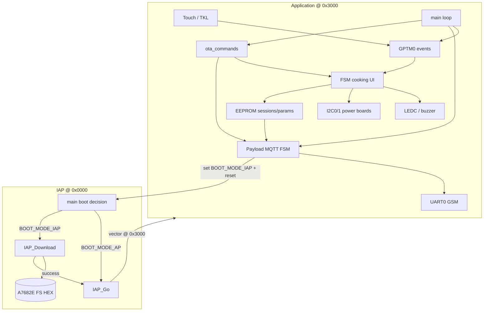

# eCOOK 3.0 — Complete Firmware Functionality Guide

| Field | Value |
| --- | --- |
| Document | Firmware Functionality Reference |
| Firmware version | 1.1.3 |
| Target MCU | Holtek HT32F54253 (ARM Cortex-M0+) |
| Images | IAP bootloader (12 KB) + AP application |
| Repository | `eCOOK3_firmware_OTA` |
| Related docs | [eCOOK3_Firmware_Specification.md](eCOOK3_Firmware_Specification.md), [CHANGELOG.md](CHANGELOG.md), [README.md](../README.md) |

This guide explains **what the firmware does**, **how each module and public function is used**, and how the **Application (AP)** and **In-Application Programming (IAP)** images work together for cooking control, cloud connectivity, and over-the-air updates.

**Section 10** documents C functions in detail: what each one does, who calls it, and what side effects it has (flash, GSM, FSM, display, etc.).

---

## Table of contents

1. [System overview](#1-system-overview)
2. [Hardware platform](#2-hardware-platform)
3. [Flash and SRAM layout](#3-flash-and-sram-layout)
4. [Dual-image boot model](#4-dual-image-boot-model)
5. [Application (AP) firmware](#5-application-ap-firmware)
6. [IAP bootloader firmware](#6-iap-bootloader-firmware)
7. [End-to-end OTA / FOTA flow](#7-end-to-end-ota--fota-flow)
8. [Module interaction map](#8-module-interaction-map)
9. [Source file index](#9-source-file-index)
10. [C function reference — what each function does](#10-c-function-reference--what-each-function-does)
    - [10.1 AP `main.c`](#101-ap-mainc)
    - [10.2 AP `FSM.c`](#102-ap-fsmc)
    - [10.3 AP `Payload.c`](#103-ap-payloadc)
    - [10.4 AP `ota_commands.c`](#104-ap-ota_commandsc)
    - [10.5 AP `EEPROM.c`](#105-ap-eepromc)
    - [10.6 AP connectivity & helpers](#106-ap-connectivity--helpers-gsm-utils-ecooker)
    - [10.7 AP UI & peripherals](#107-ap-ui--peripherals)
    - [10.8 AP timers, RTC, factory CLI](#108-ap-timers-rtc-factory-cli)
    - [10.9 AP `iap_handler.c`](#109-ap-iap_handlerc-holtek-uart-protocol)
    - [10.10 IAP `main.c`](#1010-iap-mainc)
    - [10.11 IAP jump, display, CRC, UART](#1011-iap-jump-display-crc-uart)

---

## 1. System overview

The eCOOK 3.0 firmware runs a smart electric induction stove. It is a **dual-image** design:

| Image | Location | Role |
| --- | --- | --- |
| **IAP** | `0x00000000`–`0x00002FFF` (12 KB) | Boot decision, GSM-based Intel HEX programming of the AP region, jump to AP |
| **AP** | `0x00003000` onward | Product firmware: UI, cooking FSM, I2C power boards, MQTT, session storage, OTA orchestration |

**Product capabilities (AP):**

- Capacitive touch UI, 7-segment display, red/RGB LEDs, buzzer
- Single-plate and dual-plate stove support via I2C0 / I2C1 power boards
- Cooking session logging in internal flash (emulated EEPROM)
- Cellular MQTT to AWS IoT Core (SIMCom A7682E)
- Remote commands: firmware update, parameter update, load balancer, shutoff, meta request, etc.
- Factory CLI and GSM bridge for provisioning and diagnostics

**Update capabilities (IAP + AP):**

- Cloud sends `fw` (HTTP file to modem FS) or `fota` (modem CFOTA)
- AP downloads HEX to modem filesystem, sets `BOOT_MODE_IAP`, resets
- IAP streams the HEX from the modem, programs AP flash, then boots AP

---

## 2. Hardware platform

| Component | Part / spec | Firmware role |
| --- | --- | --- |
| Main MCU | HT32F54253, 128 KB flash, 16 KB SRAM | Runs IAP + AP |
| GSM | SIMCom A7682E Cat-1 LTE | AT/MQTT/HTTP/FOTA over UART0 |
| Touch | 24-key capacitive panel (Holtek TKL) | User input → FSM events |
| Display | LEDC 4-digit 7-seg + red LEDs + 2× RGB | Power, timer, error, OTA UI |
| Power boards | I2C slaves @ `0x50` (left I2C0, right I2C1) | Power level TX, Vg/Ag/error RX |
| Battery | LiFePO4, ADC PA7 | Backup voltage monitoring |
| Buzzer | Piezo | Feedback beeps |
| RTC | Internal LSE 32.768 kHz | Epoch / shutoff helpers |

### Key pin roles (AP)

| Function | Typical pins / peripheral |
| --- | --- |
| GSM UART | UART0 (PB9 TX / PB12 RX), 115200 |
| Factory CLI | USART1, 115200 |
| Left power board | I2C0 PC8 SCL / PC9 SDA |
| Right power board | I2C1 |
| GSM PWRKEY | PB3 |
| GSM STATUS | PB6 (active-low = powered) |
| Power-board enable | PB13 / PB14 |
| Battery ADC | PA7 CH9 |

---

## 3. Flash and SRAM layout

### 3.1 Internal flash map

| Region | Address | Description |
| --- | --- | --- |
| IAP code | `0x00000000`–`0x00002FFF` | Bootloader |
| Serial ID | `0x00002C00` | 4-byte device serial |
| Secret key | `0x00002C04` | 16-byte auth key |
| Runtime params | `0x00002C20` | `RuntimeParams` (`g_params`) |
| AP code | `0x00003000`–`0x00017FFF` | Application image |
| Legacy cook slot | `0x0000FF90` | 16-byte legacy buffer |
| Session count | `0x00018C00` | `int32_t` count |
| Session store | `0x00019000`–`0x0001FF00` | 20 bytes × ~1420 sessions |
| Plate meta | `0x0001FF04` | Plate count |

Flash writes are 32-bit word aligned. Changing bits `0 → 1` requires a page erase (1 KB) with read-modify-erase-write.

### 3.2 SRAM boot / IAP control words

| Address | Macro | Purpose |
| --- | --- | --- |
| `0x20000000` | `BOOT_MODE` | `0x55AAFAF0` = AP, `0x55AAFAF5` = IAP |
| `0x20000004` | `IAP_RETRY_COUNT` | Failed IAP attempts (max 5 before giving up if AP still intact) |
| `0x20000008` | `IAP_FLASH_ERASED_FLAG` | `0xDEAD1234` = AP erased → retry IAP forever |

These words survive soft reset (`NVIC_SystemReset`) and coordinate AP ↔ IAP handoff.

### 3.3 Cooking session record (20 bytes)

Each session packs: pan, on-time, off-time, power, average current (`Ag`), average voltage (`Vg`). Power consumption (`PwrC`) is derived on read/publish, not stored. Timestamps use CLBS epoch when synced; otherwise device uptime (`device_time`).

---

## 4. Dual-image boot model

```
Reset
  │
  ▼
IAP main()
  │
  ├─ BOOT_MODE != BOOT_MODE_IAP ──► IAP_Go() → jump to AP @ 0x3000
  │
  └─ BOOT_MODE == BOOT_MODE_IAP ──► IAP_Download()
                                       │
                                       ├─ success → BOOT_MODE_AP + reset → AP
                                       └─ fail    → IAP_FailAndRetry() + reset
```

- **Cold boot / normal run:** bootloader tries to jump to AP immediately.
- **OTA path:** AP downloads HEX to modem, sets `BOOT_MODE_IAP`, resets; IAP programs flash.

---

## 5. Application (AP) firmware

Source root: `project/AP/`

### 5.1 `main.c` — initialization and super-loop

#### Init sequence (`main()`)

1. `initGlobalPayload()` — device ID / payload defaults  
2. `I2C0_Configuration()` / `I2C1_Configuration()`  
3. `GPIO_Configuration()`  
4. `BFTM0_Configuration()` / `BFTM1_Configuration()` — 1 ms / 1 s ticks  
5. `GPTM0_Configuration()` — touch event scheduling  
6. Touch library (`TKL_Configuration`)  
7. UART0 (GSM) / USART1 (CLI)  
8. `LEDC_Configuration()`  
9. RTC enable  
10. `eCooker_Configuration()` — detect single/dual plate  
11. `intializeCookNum()` — clamp session count  
12. ADC, CRC, Systick, NVIC priorities  
13. `Emulated_EEPROM_Read_RuntimeParams()`  
14. Assert PB13/PB14 (power-board enables)  
15. Enter infinite main loop  

**NVIC priorities (typical):** UART0 = 0; I2C / BFTM = 1; GPTM0 / USART1 / RTC / ADC = 2.

#### Main loop responsibilities

| Area | Behaviour |
| --- | --- |
| Plate detect | Retry `eCooker_Configuration()` until I2C reports plate type |
| UI input | `GPTM0_ProcessEvents()` → FSM |
| Factory | Blocking `cli(HT_USART1)` or GSM bridge |
| Display | `HdispSwitch()`, `updateLEDs()`, cooking/error refresh |
| Timed UI | Sync, battery, ATEC, plate-config display helpers; `checkShutoff()` |
| OTA HTTP | `updateSwitch()` → `fwDownload`; `fileSwitch()` → verify FS → `BOOT_MODE_IAP` + reset |
| Connectivity | `sendPayload()`, `payloadSend()`, MQTT/network checks |
| Cloud commands | `process_uart_json_messages()` → `dispatch_command()` |
| Events | `EVENT_ON_STATUS` / `EVENT_OFF_STATUS` / `CONNECT_COMMAND_STATUS` glue |
| Time / identity | Epoch, ICCID, CLBS location (throttled) |
| Power boards | PWM enable on PB13/14; I2C TX power + CRC; RX validation + `pg_accept_sample` |
| Safety | Error debounce; mains-loss heuristic (I2C lines idle) → forced OFF |

---

### 5.2 Finite State Machine — `FSM.c` / `FSM.h`

Controls stove behaviour from touch and system events.

#### States

| State | Role |
| --- | --- |
| `STATE_ONOFF` | Standby / off. Blocks MQTT connect. FOTA/`fw` animation runs here |
| `STATE_IDLE` | Dual stove: select left/right plate |
| `STATE_COOKING` | Active power levels, sessions, I2C CRC TX |
| `STATE_ERROR` | Declared; error UI via `EVENT_READ_ERROR` |
| `STATE_FACTORY` | CLI / diagnostics; long holds for GSM reboot / erase |
| `STATE_LOCK` | Child lock; cooking may continue |
| `STATE_SYNC` | User sync gesture; short timed return |
| `STATE_PAYGO` | Pay-as-you-go path (largely disabled) |
| `STATE_TIMER` | Enter mm:ss digits |
| `STATE_COUNTDOWN` | Running timer; BFTM1 ticks down |

#### Events (selected)

Touch keys map through `getEventFromInput()`: digits 0–9, ON/OFF, BOOST, L/R plate, LOCK, TIMER, SYNC, long-press variants, and factory entry **`EVENT_KEY_PRESS_0_B`** (0 + Boost from OFF).

#### Key public functions

| Function | Use |
| --- | --- |
| `enterState(State newState)` | Transition with side effects (beep, low-power exit, block leave-OFF during OTA animation, call `fotaUpdate()` when entering OFF) |
| `handleEvent(Event event)` | Dispatch to current state’s handler |
| `stateOnOffHandler` | Power on (requires I2C), factory entry, ATEC/plate-config gate |
| `stateIdleHandler` | Plate selection for dual stove |
| `stateCookingHandler` | Power keys, boost, timer entry, lock, session start/stop, load-balancer cap |
| `stateFactoryHandler` | Factory CLI path; long L = GSM reboot; long R = erase sessions + reset params |
| `stateLockHandler` | Child lock; may keep cooking |
| `stateSyncHandler` | Sync UI then return |
| `stateTimerHandler` / `stateCountDownHandler` | Timer digit entry and countdown |
| `getEventFromInput(u8 input)` | Map raw touch code → `Event` |
| `startSessionForSelectedPan(pan, power)` | Open cooking session; reset `pg` averages |
| `closeSession(CookingSession*)` | Close if duration > 5 s (cap 7200 s); append or overwrite last flash slot |
| `BoostMode(pan, enable)` | Dual stove: level 10 on selected pan, force opposite to 0 |
| `countdownTimeLeftRTC` / `countdownTimeRightRTC` | Expire timers → power 0 + close session |
| `syncSwitch` / `batlvlSwitch` / `atecdispSwitch` / `plateConfigSwitch` / `HdispSwitch` | Timed display helpers called from main |
| `updateCookingTimeMonitor()` | Track active cook seconds for 2 h shutoff |
| `disableHdispSwitch()` | Cancel H-display timed mode |

#### Cooking session lifecycle

1. User sets power → `startSessionForSelectedPan`  
2. User OFF / timer end / error / mains loss → `closeSession` → flash append  
3. OFF + pending sessions → payload delay → MQTT cook chunk/aggregate  
4. PUBACK → delete published range (or erase all in essential mode)

---

### 5.3 Connectivity & payloads — `Payload.c` / `Payload.h`

Manages GSM network bring-up, MQTT session, and cloud telemetry.

#### Connection FSM (`ConnState`)

`DISCONNECTED` → `NETWORK_INIT` → `NETWORK_READY` → `CONNECTING` → `CONNECTED` (→ `DISCONNECTING`)

**Network init steps (conceptual):** CPIN → ICCID → FPLMN clear → CSQ → APN → CGATT → CREG → PDP → NETOPEN → CLBS readiness.

**APN selection:** ICCID prefix `894573` → Onomondo (`onomondo`); else Aeris (`iot-eu.aer.net`).

**Strategies (`g_params.conn_strategy`):**

| Strategy | Behaviour |
| --- | --- |
| `CONN_ALWAYS_ON` | Keep MQTT up when allowed |
| `CONN_ON_DEMAND` | Connect around stove activity / uploads (default) |
| `CONN_ONCE` | Meta → errors → sessions → teardown |

MQTT connect is **blocked** in `STATE_ONOFF` and `STATE_FACTORY` (`mqttConnectAllowed()`).

#### Key public functions

| Function | Use |
| --- | --- |
| `initGlobalPayload()` | Initialize `globalPayload` (FW string, serial, stats) |
| `enterConnState` / `handleConnect` | Connection state machine |
| `networkInitCheck` / `networkInitRestart` | Advance / restart modem net init |
| `networkAllowFplmnAfterStoveOn()` | Allow another FPLMN clear after leaving OFF |
| `mqttConnectAllowed()` | Gate MQTT while stove off/factory |
| `factoryConnHold()` | Freeze connect/retry on factory entry without AT teardown |
| `connect()` / `subscribeTopic()` / `subscribeSerial()` | MQTT open + topic subscribe |
| `checkMQTTConnection()` | Parse URCs (+CMQTTPUB, connect status, etc.) |
| `mqttcheckStart` / `mqttcheckDelay` / `connCheck` / `connDelay` | Timed MQTT / connect helpers |
| `sendPayload` / `payloadSend` / `payloadDelay` | Schedule and send pending telemetry |
| `send24Hrs()` | Meta / “24 h” usage payload (`mr` can force) |
| `sendCookingSessionsChunk(offset)` | Publish session window (`num_cooking_blocks`) |
| `sendCookingSessionsAggregated()` | Essential-mode aggregate on OFF |
| `sendCookingSessions()` | Higher-level cook send entry |
| `sendRetryDetails()` | Publish retry diagnostics topic |
| `addCookSession` / `addErrC` | In-RAM queue helpers |
| `freeCookSessions()` | Free cook buffers |
| `metaForceRequest()` | Mark meta due (OTA `mr`) |
| `fwDownload(char data[])` | HTTP(S) download HEX to modem FS as `eCook3_OTA_TEST1.hex` |
| `gracefulDisconnect` / `mqttFullTeardown` | Tear down MQTT/modem session |
| `cookPublishBusy()` | True while waiting for cook PUBACK / flash update |
| `sendToGSM(const char*)` | Raw AT write to UART0 |

#### MQTT topics (typical)

| Payload | Topic pattern | Notes |
| --- | --- | --- |
| Meta / cook / errors | `usage-raw-data-topic-prod` | Production usage stream |
| Retry diag | `device-retry-topic` | Connection retry details |
| Command ack | `resp/<serial>` | OTA action responses (`pu`, `rp`, …) |

Cook publish uses `g_check_cook_publish` until `+CMQTTPUB` is handled (timeout ~60 s). Power levels use `POWER_LEVEL[2][11]` (single vs dual; dual boost index 10 = 1650 W).

---

### 5.4 OTA commands — `ota_commands.c` / `ota_commands.h`

JSON commands arrive on UART0 (modem MQTT → UART forward). Main parses up to three 320-byte JSON messages per loop and calls:

```c
bool dispatch_command(const char* ty, int cid, cJSON* root, cJSON* data);
```

**Rules:** `ty` string + numeric `cid`; duplicate `cid` ignored; flat JSON expected.

| `ty` | Effect |
| --- | --- |
| `fw` | Store URL (+ optional `xapi`) → `updateAvailable` → HTTP download in OFF |
| `fota` | Build `AT+CFOTA=...` → `fotaAvailable` → modem FOTA in OFF |
| `pu` | Patch `g_params` fields; write EEPROM if changed |
| `lb` | Set `max_power_w` + duration; cap plate power immediately |
| `so` | Remote shutoff (`shutoff_func()`) |
| `mr` | Force meta payload request |
| `rd` | Reset params to defaults + EEPROM |
| `rp` | Re-read params from flash |
| `pg` | Placeholder (`ok: false`) |

Also:

| Function | Use |
| --- | --- |
| `gsmFotaDownload(const char *atCmd)` | Issue CFOTA AT string to modem |

Globals: `updateAvailable`, `fotaAvailable`, `fw_url_buf`, `updateAnimationActive`, keep-alive / persistent change flags.

---

### 5.5 Emulated EEPROM — `EEPROM.c` / `EEPROM.h`

Persists identity, params, and cooking sessions in internal flash (no external EEPROM IC).

| Function | Use |
| --- | --- |
| `Emulated_EEPROM_Write` / `Read` | Low-level word R/W |
| `EEPROM_Write_Cook` | Legacy 16-byte cook slot at `0xFF90` |
| `Emulated_EEPROM_Write_Serial_ID` / `Read_Serial_ID` | Device serial |
| `Emulated_EEPROM_Read_Secret_Key` | 32-char hex secret for cloud auth |
| `Emulated_EEPROM_Write_Plate_Number` / `Read_Plate_Number` | Plate meta |
| `Emulated_EEPROM_Write_Cook_Session` | Append session at index |
| `Emulated_EEPROM_Overwrite_Last_Cook_Session` | When store full |
| `Emulated_EEPROM_Write_Cooking_Session_Num` / `Read_...` | Session count |
| `Emulated_EEPROM_Get_Effective_Session_Count` | Clamped/effective count |
| `intializeCookNum()` | Boot-time count sanitize |
| `Emulated_EEPROM_Erase_All_Cook_Sessions` | Full erase |
| `Emulated_EEPROM_Delete_Cook_Sessions_Range` | Compact delete after MQTT ACK |
| `Emulated_EEPROM_Write_RuntimeParams` / `Read_RuntimeParams` | Persist `g_params` |

---

### 5.6 Stove detection — `eCooker.c` / `eCooker.h`

| Function | Use |
| --- | --- |
| `eCooker_Configuration()` | Set FW string; detect single vs dual from I2C RX plate bytes / I2C1 presence; set `ecConfig` |
| `isStoveI2cConnected()` | True if either I2C master-connected flag is set |

---

### 5.7 GSM power helpers — `gsm.c` / `gsm.h`

| Function | Use |
| --- | --- |
| `GSMpoweron(u16 pulseLength)` | Pulse PB3 PWRKEY |
| `isGSMpoweredUp()` | Read PB6 STATUS |
| `GSMreboot()` | Power cycle + AT probe |
| `GSMisReadyForAT()` | Powered + UART AT OK |
| `gsmApplyA7682eUpstreamTcpMssClamp()` | `AT+CSOC` MSS 1240 |
| `gsmWaitForBootQuiet(quiet_ms, max_ms)` | Wait for post-boot UART silence |

Heavy AT/MQTT/CLBS logic also lives in `Utils.c` and `Payload.c`.

---

### 5.8 Utilities — `Utils.c` / `Utils.h`

#### Runtime parameters (`RuntimeParams` / `g_params`)

| Field | Default | Purpose |
| --- | --- | --- |
| `keep_alive_s` | 600 | MQTT keep-alive |
| `payload_mode` | `PAYLOAD_ALL` | Full vs essential cook payloads |
| `conn_strategy` | `CONN_ON_DEMAND` | Connection policy |
| `max_power_w` | 10 | Load-balancer level cap |
| `meta_payload_interval_s` | 86400 | Meta interval |
| `send_cooking_sessions` | true | Enable cook TX |
| `send_error_payloads` | true | Enable error TX |
| `send_meta_payloads` | true | Enable meta TX |
| `lb_cap_until_epoch` | — | Cap expiry |
| `persistent_flag` | 0 | MQTT persistent session |
| `num_cooking_blocks` | 2 | Sessions per MQTT chunk (1–10) |

#### Key functions

| Function | Use |
| --- | --- |
| `params_reset_to_defaults()` | Restore `g_params` defaults (OTA `rd`) |
| `shutoff_func()` | Full local OFF transition (OTA `so`) |
| `mqtt_send_action_response(type, cid, ok, qos)` | MQTT ack JSON on `resp/<serial>` |
| `geticcid()` / `getimei()` | Modem identity strings |
| `GSMsendATCommand` / `GSMprobeATUartOk` / `gsmWaitForAtHandshake` | AT helpers |
| `gsmCfun0Then1()` | Soft radio restart |
| `gsm_clear_fplmn` / `gsmAllowFplmnWriteAfterGsmReboot` | SIM FPLMN recovery |
| `fetchCLBSEpochTime` / `extractCoordinatesFromCLBS` / `synctime` | Time & location |
| `getBatV()` | Battery volts from ADC sample |
| `Systick_Configuration` / `Systick_Delay_us` | Microsecond timing |
| `strlcpy0` | Safe string copy |
| `resetCLBSModemAttemptCount` / `gsmNetworkReadyForClbs` | CLBS budget / gate |
| `resetCGSNRetryCountOnGSMReset` | IMEI retry after modem reset |

---

### 5.9 Touch UI — `TouchFunction.c` / `TouchFunction.h`

Integrates Holtek Touch Key Library with factory long-holds and sleep.

| Function | Use |
| --- | --- |
| `TKL_Configuration` / `TKL_InitConfig` / `SetTouchKeyAFIO` | Touch bring-up |
| `Touch_Key_Main_Function` / `Key_Scan` / `Key_Task` | Scan path used with GPTM0 |
| `DeepSleepMode_Configuration` | Deep-sleep setup |
| `EnterSleepModePrepare` / `ExitSleepModePrepare` | Sleep entry/exit prep |
| `TouchFunction_UpdateFactoryLPanHold` / `...RPanHold` | Track long plate holds in factory |
| `TouchFunction_FactoryLPanLedPoll` / `...RPanLedPoll` | LED feedback during hold |
| `TouchFunction_ResetFactoryLPanHold` / `...RPanHold` | Clear hold state |

**Note:** `keyScan.c` is a legacy debug path; production uses GPTM0 + `Key_Task()`.

---

### 5.10 Display — `LEDC.c` / `LEDC.h`

| Function | Use |
| --- | --- |
| `LEDC_Configuration()` | Init LEDC / 7-seg / AFIO |
| `LEDC_redLED` / `LEDC_setSingleRedLED` / `LEDC_allRedLEDs` / `LEDC_turnOffAllRedLEDs` | Red key indicators |
| `LEDC_rgbLED` | Sync / paygo RGB |
| `writeSevenSegAscii` / `writeSevenSegInt` / `writeSevenSegDP` | Raw 7-seg |
| `writeTimeToSevenSeg` / `writePowerLevel` / `writeBoostLevel` | Cooking UI |
| `writeErrCodeToSevenSeg` / `writeLineToSevenSeg` / `writeATECToSevenSeg` / `writeSYNCToSevenSeg` | Special screens |
| `writeBatLevel` / `displayLast4DigitsOfSerial` / `displayFirmwareVersion` | Info screens |
| `handleSyncLED` / `handlePaygoLED` / `handleHdisplay` / `updateLEDs` | Composite UI updates |
| `clearSevenSegDisplay` | Blank digits |
| `runLoadingAnimationNonBlocking` / `runBlockingAnimation*` | OTA / wait animations |

---

### 5.11 I2C power boards — `I2C0.c` / `I2C1.c`

Slave address **0x50**, 100 kHz.

**TX frame (MCU → board):** plate id, power 0–10, temp 0, CRC16 over first three bytes.  
**RX frame (board → MCU):** mfg, plate, error (8 = none), Vg, Ag, CRC, checksum.

| Function (I2C0 / I2C1) | Use |
| --- | --- |
| `I2C0_Configuration` / `I2C1_Configuration` | Init slave + pins |
| `I2C0_DeInit` / `I2C1_DeInit` | Tear down |
| `i2cSlaveSend2` / `i2c_1_SlaveSend2` | Transmit command buffer |
| `i2cSlaveReceive` / `i2c_1_SlaveReceive` | Receive status (polled from BFTM0 1 ms) |
| `I2C0_err_detect` / `I2C1_err_detect` | Error detect helpers |
| `i2c0_status` / `i2c1_status` | Connection/status update |
| Low-power EXTI / bus release helpers | Wake from deep sleep on SDA activity |

Main loop validates RX CRC and feeds `pg_accept_sample()` during active sessions.

---

### 5.12 Timers — `BFTM0.c` / `GPTM0.c`

| Function | Use |
| --- | --- |
| `BFTM0_Configuration()` | 1 ms tick: touch timer, I2C RX poll, WDT kick, factory LED poll |
| `BFTM1_Configuration()` | 1 s tick: `device_time`, epoch helpers, countdown, cooking monitor, shutoff counter |
| `BFTM0_Delay_ms(ms)` | Busy-wait delay |
| `GPTM0_Configuration()` | Schedule touch main + enqueue events |
| `GPTM0_ProcessEvents()` | Dequeue → `handleEvent()` (reentrancy guarded) |

---

### 5.13 RTC & shutoff — `RTC.c` / `RTC.h`

| Function | Use |
| --- | --- |
| `RTC_Configuration` / `RTC_For_WakeUp_Configuration` | LSE RTC setup |
| `getEpochTimeRTC()` | Read RTC-based epoch helper |
| `__init__RTCEpoch()` | CLBS epoch init with bounded attempts |
| `checkShutoff()` | **2 h** max active cook; **10 min** idle at zero power → shutoff |
| `deviceInteraction` / `deviceInteractionIdle` | Reset idle/shutoff counters on UI activity |
| `resetEpochRetryStateOnGSMReset()` | Retry epoch after modem reset |

---

### 5.14 Supporting peripherals

#### Battery — `batVoltage.c`

| Function | Use |
| --- | --- |
| `ADC_Configuration()` | Continuous ADC CH9; EOC ISR updates `gBATVoltageLevel` |

#### Buzzer — `buzzer.c`

| Function | Use |
| --- | --- |
| `buzz(mS)` | Short beep |
| `Buzzer_LongBeep(freq, ms)` | Timed PWM tone |

#### CRC — `CRC.c`

| Function | Use |
| --- | --- |
| `CRC_Configuration()` | HW CRC-16 init (seed `0xFFFF`) |
| `CRC_16(...)` (via CRC module) | I2C frame integrity |

#### GPIO — `GPIO.c`

| Function | Use |
| --- | --- |
| `GPIO_Configuration()` | PB2 status, PB3 PWRKEY, PB6 STATUS, PB13/14 enables, charge pins |
| `GPIO_Sleep_Mode_Configuration()` | Sleep pin states |

#### USART1 / CLI — `USART1.c` / `cli.c`

| Function | Use |
| --- | --- |
| `USART1_Configuration` / `USART1_init_buffer` | Factory UART |
| `USART1_getchar` / `USART1_tx_data` / `USART1_getBufferSpace` | RX/TX helpers |
| `cli(HT_USART_TypeDef*)` | Factory command shell (LEDs, 7-seg, GSM power/bridge, erase cooks, provision serial/secret, etc.) |
| `my_fprintf(...)` | Formatted CLI output |

GSM bridge mode (`isGSMbridge`) pass-through USART1 ↔ UART0 for modem debugging.

#### Stove stats — `stove_stats.c`

| Function | Use |
| --- | --- |
| `pg_avg_reset()` | Clear Ag/Vg/Pg averages at session start |
| `pg_accept_sample(ag, vg)` | Feed filtered samples during cook |

#### AP IAP UART protocol — `iap_handler.c` (AP)

Holtek-style **64-byte UART IAP command** slave (CRC16, optional command key). Distinct from product GSM OTA.

| Function | Use |
| --- | --- |
| `IAP_Init()` | Init Holtek IAP channel |
| `IAP_CMDHandler(u8 *buf)` | Process command packet |
| `IAP_Reset(u32 mode)` | Set `BOOT_MODE` AP/IAP + system reset |
| `IAP_SlavePullHandshake()` | Handshake helper |
| `IAPUser_CmdProcess` / send/reset helpers | User command hooks |

**Field OTA does not use this path.** Grep shows it is not driven from AP `main.c` in the normal product loop; GSM HTTP + IAP bootloader is the production updater.

#### Interrupts — `ht32f5xxxx_01_it.c`

- HardFault → immediate reset (AP)  
- Touch key IRQ → `TKL_IRQHandler`  
- ADC EOC → battery sample  
- EXTI4_15 → I2C low-power wake flags  

---

## 6. IAP bootloader firmware

Source root: `project/IAP/`  
Build: Keil `MDK_ARMv5/IAP.uvprojx`, IROM limited to **12 KB** (`0x0000`–`0x2FFF`).

The IAP image is a **custom GSM OTA bootloader**. It is derived from Holtek’s UART IAP template, but the live path uses **UART0 + A7682E filesystem**, not a host UART programmer.

### 6.1 Boot entry — `main.c`

```c
int main(void)
```

1. `NVIC_Configuration`, `CKCU_Configuration`, `GPIO_Configuration`, `USART_Configuration` (UART0)  
2. `BFTM0_Configuration`, `LEDC_Configuration`  
3. Optional `IAP_TEST_MODE` forces IAP mode and clears retry/erased flags  
4. If `BOOT_MODE != BOOT_MODE_IAP` → clear erased flag → `IAP_Go()` (jump AP)  
5. Else → `IAP_Download()`  
6. Fallback infinite `NVIC_SystemReset`

| Function | Use |
| --- | --- |
| `IAP_Download()` | Full GSM HEX programming pipeline (see below) |
| `parseHexLine(...)` | Parse one Intel HEX record (types 0x00 data, 0x04 ext addr, 0x01 EOF) |
| `NVIC_Configuration` / `CKCU_Configuration` / `GPIO_Configuration` / `USART_Configuration` | Clock, pins, UART0 @ 115200 |
| `USART_SEND_DATA` / `USART_RECV_DATA` | **Empty Holtek stubs** (unused by GSM path) |

Static helpers inside `main.c`: `IAP_FailAndRetry`, `IAP_WaitForGSMReady`, `IAP_SendATWithRetry`, `IAP_isGSMpoweredUp`, `IAP_GSMpoweron`.

### 6.2 `IAP_Download()` — programming pipeline

1. **`WDT_DeInit()`** — AP may leave WDT running across soft reset; download can take tens of seconds.  
2. Power GSM (PB3), wait STATUS (PB6), up to two 10 s attempts.  
3. Wait for UART quiet (`IAP_WaitForGSMReady(3000, 20000)`).  
4. AT init: `ATE0`, `AT+CMEE=0`, `AT+FSLS`, `AT+FSATTRI=eCook3_OTA_TEST1.hex` → file length.  
5. Set `IAP_FLASH_ERASED_FLAG = 0xDEAD1234`, erase all AP pages `IAP_APFLASH_START`…`END`.  
6. Loop file offset += 128:  
   - `AT+CFTRANTX="C:/eCook3_OTA_TEST1.hex",offset,240,1`  
   - Up to 3 retries; require `OK` and `':'` in RX  
   - Clean buffer → parse HEX lines → `FLASH_ProgramWordData` (skip `0xFFFFFFFF`)  
   - Advance 7-seg loading animation  
7. **Success** only if no flash errors **and** EOF record `0x01` seen → clear flags, `BOOT_MODE_AP`, reset.  
8. Else `IAP_FailAndRetry()`.

**Chunk size:** 128-byte offset steps; modem transfer length 240 in CFTRANTX.

> Spec text may mention `AT+FSREAD`; the **implemented** command is **`AT+CFTRANTX`**.

### 6.3 Failure / anti-brick — `IAP_FailAndRetry`

1. Show `----` on 7-seg, delay 2 s.  
2. If AP flash already erased (`IAP_FLASH_ERASED_MAGIC`) → stay in IAP forever (retry until success).  
3. Else increment `IAP_RETRY_COUNT`; if ≥ 5 → fall back to `BOOT_MODE_AP`; else stay IAP; reset.

### 6.4 Jump to AP — `iap_handler.c` / `iap_handler.h`

| Function | Use |
| --- | --- |
| `IAP_Go()` | Read SP/PC at `0x3000`; validate; disable UART IRQ; relocate vector table; call `IAP_GoCMD` |
| `IAP_GoCMD(u32 address)` | Assembly: load SP, branch to Thumb reset handler |

Invalid SP/PC → silent return → falls into download path.

### 6.5 CRC / ARC4 / config

| Module | Role in product IAP |
| --- | --- |
| `crc16.c` — `CRC16(crc, buf, len)` | CCITT poly `0x1021`; running CRC accumulated during download but **not verified** against a stored value |
| `arc4.c` / `arc4.h` | mbedTLS ARC4 sources present; **not linked** in `IAP.uvprojx` |
| `iap_config.h` | Holtek template flags (ARC4, command key, digest, timeout, blink LED) — **mostly inactive** in this GSM bootloader |

Security for field updates relies on cloud auth + modem HTTPS path and HEX programming integrity (EOF required), not Holtek ARC4 packet encryption in IAP.

### 6.6 IAP display & timebase

#### `LEDC.c` (IAP)

| Function | Use |
| --- | --- |
| `LEDC_Configuration()` | Init display |
| `runLoadingAnimationNonBlocking()` | Spinner during each chunk |
| `writeLineToSevenSeg()` | Failure UI (`----`) |
| `clearSevenSegDisplay()` | Blank before reboot to AP |
| `writeATECToSevenSeg` / `writeSevenSegInt` / `LEDC_rgbLED` | Available helpers |

#### `BFTM0.c` (IAP)

| Function | Use |
| --- | --- |
| `BFTM0_Configuration()` | 1 ms `bftm0_ct` |
| `BFTM0_Delay_ms` | All IAP delays / AT spacing |
| `BFTM1_Configuration` | Present; not required for OTA path |

### 6.7 IAP interrupts — `ht32f5xxxx_01_it.c`

Default fault handlers; legacy `USART1_IRQHandler` Holtek UART IAP state machine remains but is **unused** by the GSM path (UART0 + `utilities/UART0.c` is used instead).

### 6.8 IAP test mode (`ht32_board_config.h`)

| Macro | Injected fault |
| --- | --- |
| `IAP_TEST_MODE` | Master enable |
| `IAP_TEST_FAIL_GSM_POWER` | GSM never powers |
| `IAP_TEST_FAIL_AT_CMD` | Zero file attribute |
| `IAP_TEST_FAIL_CHUNK_N` | Fail at chunk N |
| `IAP_TEST_FAIL_FLASH_WRITE` | Flash program fail |
| `IAP_TEST_FAIL_NO_EOF` | Truncated HEX |

Leave all at `0` for production.

### 6.9 External dependency — `utilities/UART0.c`

Shared by IAP (and AP): GSM ring buffer, `sendToGSM`, response helpers, hex buffer cleanup, `parse_file_attribute`, `IAP_Buffer`.

---

## 7. End-to-end OTA / FOTA flow

### 7.1 HTTP firmware update (`ty: "fw"`)

```
Cloud MQTT JSON { ty:"fw", cid, data:{url,...} }
        │
        ▼
AP dispatch_command → updateAvailable, fw_url_buf
        │
        ▼
User/stove in STATE_ONOFF → update animation → AT+CRESET (modem)
        │
        ▼
~25 s later → fwDownload() HTTP(S) → save C:/eCook3_OTA_TEST1.hex on modem FS
        │
        ▼
~5 s later → verify file on FS → BOOT_MODE = IAP → NVIC_SystemReset
        │
        ▼
IAP_Download() erases AP, CFTRANTX chunks, programs flash, EOF → BOOT_MODE_AP → reset
        │
        ▼
IAP_Go() → new AP runs
```

**Images:**

- Factory / recovery: combined HEX (IAP+AP) via e-Link32 Pro ICP  
- Field OTA: **AP-only** HEX (e.g. `RELEASE/eC3_113_AP_*.hex`)

### 7.2 Modem FOTA (`ty: "fota"`)

AP builds CFOTA AT string; in `STATE_ONOFF`, `fotaUpdate()` / `gsmFotaDownload()` lets the **modem** update itself (modem firmware path), separate from MCU AP flash programming.

---

## 8. Module interaction map



---

## 9. Source file index

### 9.1 Application (`project/AP/`)

| File | Purpose |
| --- | --- |
| `main.c` | Init, super-loop, JSON OTA ingress, I2C validation, fw state machine |
| `FSM.c` / `FSM.h` | Stove UI state machine, sessions, boost, timers |
| `Payload.c` / `Payload.h` | Network/MQTT FSM, telemetry, HTTP fw download |
| `ota_commands.c` / `ota_commands.h` | Cloud command dispatch |
| `EEPROM.c` / `EEPROM.h` | Flash persistence |
| `eCooker.c` / `eCooker.h` | Single/dual detection |
| `gsm.c` / `gsm.h` | Modem power/status |
| `Utils.c` / `Utils.h` | AT helpers, params, CLBS, shutoff, MQTT acks |
| `TouchFunction.c` / `TouchFunction.h` | Touch lib + sleep + factory holds |
| `LEDC.c` / `LEDC.h` | Display |
| `I2C0.c` / `I2C1.c` (+ `.h`) | Power-board protocol |
| `GPTM0.c` / `BFTM0.c` | Touch events / system ticks |
| `RTC.c` / `RTC.h` | Epoch helpers, auto-shutoff |
| `cli.c` / `USART1.c` | Factory console |
| `stove_stats.c` | Ag/Vg averaging |
| `batVoltage.c` / `buzzer.c` / `CRC.c` / `GPIO.c` | Supporting HW |
| `iap_handler.c` | Holtek UART IAP protocol (dormant in product loop) |
| `keyScan.c` | Legacy touch debug |

### 9.2 IAP (`project/IAP/`)

| File | Purpose |
| --- | --- |
| `main.c` | Boot decision, `IAP_Download`, HEX parse/program |
| `iap_handler.c` / `.h` | `IAP_Go` jump to AP |
| `iap_config.h` | Holtek IAP options (mostly unused here) |
| `ht32_board_config.h` | Flash split, boot flags, retry/erased magic, test hooks |
| `crc16.c` / `.h` | CRC16 helper |
| `arc4.c` / `.h` | ARC4 sources (not linked) |
| `LEDC.c` / `BFTM0.c` | Loading UI and ms delays |
| `ht32f5xxxx_01_it.c` | Faults + legacy USART1 IAP IRQ |
| `system_ht32f5xxxx_09.c` | CMSIS SystemInit |

### 9.3 Shared utilities

| Path | Use |
| --- | --- |
| `utilities/UART0.c` | GSM UART buffers and AT helpers for AP and IAP |
| `utilities/common/memory_utils.c` | Page-preserving flash erase helpers |
| `MDK_ARMv5/` | Keil projects, `iap.s` embedding, release maps |
| `RELEASE/` | Combined and AP-only shipping HEX files |

---

## 10. C function reference — what each function does

Each entry describes **what the function does**, **who calls it**, and **side effects**. Callers list principal sites, not every reference.

---

### 10.1 AP `main.c`

#### `main(void)`
- **Does:** Boots the product: initializes payload, I2C0/1, GPIO, BFTM0/1, GPTM0, touch, UART0/USART1, LEDC, RTC, eCooker, cook-session count, ADC, CRC, Systick, NVIC priorities, then loads `g_params` from flash. Runs the infinite super-loop that drives UI events, factory CLI, display helpers, OTA pipeline, MQTT/payload, JSON command dispatch, epoch/ICCID/CLBS, I2C power-board traffic, error logging, mains-loss shutoff, and energy sampling.
- **Called from:** Reset vector (after IAP jumps to AP).
- **Side effects:** Entire product behaviour — flash, GSM, FSM, I2C, MQTT, deep sleep.

#### `process_uart_json_messages(void)`
- **Does:** Returns immediately if `cookPublishBusy()`. Otherwise pops up to three JSON strings from the UART0 command ring, parses `ty` / `cid` / `data`, ignores duplicate `cid` (`last_cid`), and calls `dispatch_command()`.
- **Called from:** Main loop (after sleep gate).
- **Side effects:** Runs OTA handlers (params flash, power cap, shutoff, FOTA/fw flags, MQTT acks).

#### `update(void)`
- **Does:** When `updateAvailable` and stove is `STATE_ONOFF`: turns off H-display, clears 7-seg, blinks blue sync LED, starts loading animation, sends `AT` then `AT+CRESET`, resets GSM/epoch retry state, clears `mqtt_service_started`, sets `reset`, clears `updateAvailable`.
- **Called from:** Main loop.
- **Side effects:** Modem soft reset; UI animation globals (`updateAnimationActive`).

#### `updateDelay(void)` / `updateSwitch(void)`
- **Does:** `updateDelay` arms `update_bftm0` after modem comes back. `updateSwitch` waits ~25 s, then calls `fwDownload(fwUpdate.data)` and `fileDelay()`.
- **Called from:** Main loop (`updateSwitch` every iteration; `updateDelay` after `update()` reset path).
- **Side effects:** HTTP download to modem filesystem; timing globals.

#### `fileDelay(void)` / `fileSwitch(void)`
- **Does:** `fileDelay` starts a 5 s post-download window. `fileSwitch` then reconnects MQTT briefly; if HEX `eCook3_OTA_TEST1.hex` is found on modem FS (`findHexFilenameInFSLS`), sets `BOOT_MODE_IAP` and `NVIC_SystemReset()`; on failure clears OTA flags, buzzes, shows `----`.
- **Called from:** Main loop; `fileDelay` from `updateSwitch`.
- **Side effects:** Soft reset into IAP bootloader; display/LED; MQTT connect attempt.

#### `fotaUpdate(void)`
- **Does:** If `fotaAvailable` and `STATE_ONOFF`, runs `gsmFotaDownload(fwUpdate.data)` (modem `AT+CFOTA=...`). Clears `fotaAvailable` only on success.
- **Called from:** `enterState(STATE_ONOFF)`.
- **Side effects:** Modem FOTA AT command (modem firmware, not MCU AP flash).

#### `get_first_20_chars` / `are_all_digits`
- **Does:** Helpers to copy/validate the first 20 ICCID digits.
- **Called from:** Main ICCID validation path.
- **Side effects:** None.

#### `Set_Interrupt_Priority(void)`
- **Does:** Sets NVIC priorities and enables UART0, I2C0/1, BFTM0/1, GPTM0, USART1, RTC, ADC IRQs.
- **Called from:** `main()` once at boot.
- **Side effects:** Interrupt ordering.

---

### 10.2 AP `FSM.c`

#### `enterState(State newState)`
- **Does:** IRQ-masked transition. Blocks leaving `STATE_ONOFF` while OTA animation is active. Beeps on most transitions. Leaving OFF wakes touch (`TKL_LowPowerExit`) and allows FPLMN clear. Entering OFF zeros I2C power and runs `fotaUpdate()`. Entering FACTORY resets factory touch holds and calls `factoryConnHold()`.
- **Called from:** State handlers, shutoff, RTC, Utils, OTA `so`, main.
- **Side effects:** `currentState`; network/MQTT hold; FOTA; I2C TX buffers.

#### `handleEvent(Event event)`
- **Does:** Dispatches `event` to the handler for `currentState`.
- **Called from:** `GPTM0_ProcessEvents`.
- **Side effects:** Whatever the active state handler does.

#### `getEventFromInput(u8 input)`
- **Does:** Maps raw touch key code to `Event` (digits, plates, lock, timer, boost, sync, long-press, factory `0`+Boost).
- **Called from:** `GPTM0_ProcessEvents`.
- **Side effects:** None.

#### `stateOnOffHandler(Event event)`
- **Does:** Standby behaviour. ON requires `isStoveI2cConnected()`; may show ATEC/plate-config first, then set `EVENT_ON_STATUS` and go IDLE (dual) or COOKING (single). Long LOCK → battery display. Long SYNC → toggles `PayloadOption`. `EVENT_KEY_PRESS_0_B` → factory mode.
- **Called from:** `handleEvent` when `STATE_ONOFF`.
- **Side effects:** FSM, GSM AT probe on turn-on, display, event flags.

#### `stateIdleHandler(Event event)`
- **Does:** Dual-stove plate selection → COOKING. OFF → `STATE_ONOFF` + `EVENT_OFF_STATUS`. Lock/sync long-press handling.
- **Called from:** `handleEvent` when `STATE_IDLE`.
- **Side effects:** Plate selection, OFF event for MQTT cook drain.

#### `stateCookingHandler(Event event)`
- **Does:** Enforces `g_params.max_power_w` / LB expiry. Handles power keys 0–9, boost, timer, lock, sync. OFF clears plates, closes sessions, sets `EVENT_OFF_STATUS`.
- **Called from:** `handleEvent` when `STATE_COOKING`.
- **Side effects:** Sessions, I2C power, display, MQTT off-event.

#### `stateTimerHandler` / `stateCountDownHandler`
- **Does:** Digit entry for MM:SS; confirm starts countdown. Long timer cancel returns to cooking. Expiry path zeros power and closes session (via RTC countdown helpers).
- **Called from:** `handleEvent`.
- **Side effects:** Timer digits, FSM, I2C, sessions.

#### `stateFactoryHandler(Event event)`
- **Does:** Factory diagnostics (serial, cook count, FW version). Long left-plate hold → `GSMreboot` + MCU reset. Long right-plate hold → erase all cook sessions, reset params to flash, MCU reset.
- **Called from:** `handleEvent` when `STATE_FACTORY`.
- **Side effects:** Flash erase; GSM reboot; system reset.

#### `stateLockHandler` / `stateSyncHandler` / `statePayGoHandler`
- **Does:** Lock: long LOCK returns to `previousState` (cooking continues while locked). Sync: long SYNC runs `gsmCfun0Then1` and MQTT reconnect. PayGo: mostly stub paths back to IDLE.
- **Called from:** `handleEvent`.
- **Side effects:** FSM; GSM CFUN; MQTT connect.

#### `startSessionForSelectedPan(uint8_t pan, uint16_t power)` / `startSession(...)`
- **Does:** Closes any prior session on that pan, sets `onTime` (epoch if synced else `device_time`), marks active, calls `pg_avg_reset()`, builds I2C TX buffer with plate/power/CRC.
- **Called from:** Cooking handler, boost, LB clamp, timer/error recovery.
- **Side effects:** Session globals; I2C TX; stove stats reset.

#### `closeSession(CookingSession* session)`
- **Does:** If session active: set `offTime`; if duration > 5 s (cap 7200 s) write to flash (append or overwrite last slot when full) with `Ag`/`Vg` from `globalPayload.stat`; clear session; `updateCookingTimeMonitor()`.
- **Called from:** Power off, timers, errors, shutoff, GPTM0 error path, main `turnOff`.
- **Side effects:** **Flash cook store**; `cook_done`.

#### `BoostMode(uint8_t selected_pan, bool enable)`
- **Does:** Enable: set selected pan to power 10, force opposite pan to 0, clear opposite timer, update I2C/display. Disable: restore previous power and may restart session.
- **Called from:** Cooking handler, `command_lb`.
- **Side effects:** Plate state, I2C, sessions, 7-seg/LEDs.

#### `updateCookingTimeMonitor(void)`
- **Does:** Sets `cookingTimeMonitor.left_seconds` / `right_seconds` from active sessions (capped at 7200).
- **Called from:** Session start/close, `BFTM1_IRQHandler`.
- **Side effects:** Monitor used by `checkShutoff` and payload scheduling.

#### `countdownTimeLeftRTC` / `countdownTimeRightRTC`
- **Does:** 1 Hz countdown (from BFTM1). Auto-return to cooking after short dwell in countdown UI. On expiry: power 0, I2C CRC update, `closeSession`, buzz.
- **Called from:** `BFTM1_IRQHandler`.
- **Side effects:** Power, I2C, sessions, FSM, buzzer.

#### `syncSwitch` / `batlvlSwitch` / `atecdispSwitch` / `plateConfigSwitch` / `HdispSwitch` / `disableHdispSwitch`
- **Does:** Time-limited UI restore after sync / battery / ATEC / plate-config / H-display delays. `plateConfigSwitch` can auto-continue turn-on once plate type is known.
- **Called from:** Main loop.
- **Side effects:** Display, FSM transitions, `EVENT_ON_STATUS`, occasional GSM AT.

#### Delay arm helpers (`syncDelay`, `ATECdispDelay`, `plateConfigDelay`, `batlvlDelay`, `HDelay`, `eventDelay`)
- **Does:** Clear `*Triggered` and stamp `*_bftm0` so the matching `*Switch` runs later.
- **Called from:** State handlers / user actions.
- **Side effects:** Timing flags only.

---

### 10.3 AP `Payload.c`

#### `initGlobalPayload(void)`
- **Does:** Initializes `globalPayload` (device ID, stats pointers, STL buffer).
- **Called from:** `main()` boot.
- **Side effects:** Global payload struct.

#### `enterConnState(ConnState)` / `handleConnect(ConnEvent)` / `connect(void)`
- **Does:** Connection FSM. `connect()` runs `AT+CMQTT*` TLS setup (certs, keepalive, persistent) when `mqttConnectAllowed()`. CONNECTED may call `subscribeTopic()`.
- **Called from:** Network init completion, ON event, sync reconnect, OTA post-download.
- **Side effects:** GSM MQTT session; `currentConnState`.

#### `mqttConnectAllowed(void)`
- **Does:** Returns false in `STATE_ONOFF` or `STATE_FACTORY` (MQTT must not start while stove off/factory).
- **Called from:** Connect path / network init.
- **Side effects:** None.

#### `factoryConnHold(void)`
- **Does:** Freezes connect/retry locally without destructive GSM teardown ATs (used on factory entry).
- **Called from:** `enterState(STATE_FACTORY)`.
- **Side effects:** Conn FSM held.

#### `networkInitCheck` / `networkInitRestart` / `networkAllowFplmnAfterStoveOn`
- **Does:** Step machine: CPIN → ICCID/APN → FPLMN → CSQ → CGATT → CREG → PDP → NETOPEN → CLBS readiness. Failures trigger CFUN reset/backoff. Success → `NETWORK_READY` or `connect()`. `networkAllowFplmnAfterStoveOn` allows another FPLMN write after leaving OFF.
- **Called from:** Main loop / stove ON path.
- **Side effects:** Many AT commands; APN selection (Onomondo vs Aeris); conn state.

#### `checkMQTTConnection(void)`
- **Does:** Parses `+CMQTTCONNECT` URCs (does not treat query replies as failure), handles cook PUBACK path, CONNECTING query fallback.
- **Called from:** Main loop.
- **Side effects:** Conn state; cook publish ACK → flash delete.

#### `gracefulDisconnect` / `mqttFullTeardown`
- **Does:** Stop MQTT; teardown often leaves cellular at `NETWORK_READY` when strategy needs it.
- **Called from:** OFF/shutoff/ON-demand end / publish failure paths.
- **Side effects:** MQTT stopped; AT teardown sequence.

#### `subscribeTopic` / `subscribeSerial` / `get_serial_id_length`
- **Does:** Subscribe to cloud command topics keyed by device serial.
- **Called from:** After MQTT CONNECT.
- **Side effects:** MQTT subscribe ATs.

#### `sendPayload(void)` / `payloadSend(void)` / `payloadDelay(void)`
- **Does:** Central telemetry scheduler by `conn_strategy` / `payload_mode`: cook upload, errors (≥3), meta. `payloadDelay` arms 3 s then `payloadSend` ships cook chunks from flash offset.
- **Called from:** Main loop.
- **Side effects:** MQTT publishes; flash erase after ACK; GSM sleep (`AT+CSCLK=2`) when idle-off.

#### `send24Hrs(void)` / `metaForceRequest(void)`
- **Does:** Build/publish meta JSON (BatV, STL, stvcnt, sid, loc); may `AT+CSCLK=2`; reset counters. `metaForceRequest` marks meta due (OTA `mr`).
- **Called from:** `sendPayload`; `command_mr`.
- **Side effects:** MQTT; modem sleep clock; stats counters.

#### `sendCookingSessionsChunk(int offset)` / `sendCookingSessionsAggregated` / `sendCookingSessions`
- **Does:** Publish cook sessions from EEPROM — chunked (`num_cooking_blocks`) or one aggregated essential message.
- **Called from:** `payloadSend` / `sendPayload`.
- **Side effects:** MQTT; starts cook ACK watchdog (`g_check_cook_publish`).

#### `sendMultipleErrorPayload` / `sendRetryDetails`
- **Does:** Publish batched errors; publish connection-retry diagnostics to `device-retry-topic`.
- **Called from:** `sendPayload` / once strategy.
- **Side effects:** MQTT; frees error buffers.

#### `addCookSession` / `addErrC` / `freeCookSessions`
- **Does:** In-RAM payload assembly helpers (parallel to flash cook path).
- **Called from:** Older/secondary payload paths.
- **Side effects:** Heap/RAM arrays.

#### `cookPublishBusy(void)`
- **Does:** True while waiting for cook PUBACK or during the 3 s chunk delay window.
- **Called from:** Main (blocks deep sleep and JSON dispatch), shutoff paths.
- **Side effects:** None.

#### `fwDownload(char data[])`
- **Does:** Delete old HEX on modem FS if needed; HTTP(S) download; `HTTPREADFILE` to `C:/eCook3_OTA_TEST1.hex`; set `fwUpdate.success`.
- **Called from:** `updateSwitch`.
- **Side effects:** Modem filesystem; HTTP AT sequence; `downloadInProgress`.

#### `gsmFotaDownload(const char *atCmd)`
- **Does:** Sends raw `AT+CFOTA...`, polls OK/ERROR.
- **Called from:** `fotaUpdate` / ota_commands.
- **Side effects:** Modem FOTA process.

#### `sendToGSM(const char* data)`
- **Does:** Write AT string (+CRLF) to UART0.
- **Called from:** Many Payload/Utils paths.
- **Side effects:** UART TX.

#### `connCheck` / `connDelay` / `mqttcheckStart` / `mqttcheckDelay`
- **Does:** Timed helpers to reconnect MQTT or poll cook publish result after delays.
- **Called from:** Main loop.
- **Side effects:** May call `handleConnect` / cook ACK checks.

#### `updatePayload` / related periodic updaters
- **Does:** Refresh STL string and device MC from I2C CRC periodically.
- **Called from:** Payload scheduling.
- **Side effects:** `globalPayload` fields.

#### `storeFailedEraseRest(void)`
- **Does:** Rebuild/compact flash after failed chunk publish recovery.
- **Called from:** Cook publish failure path.
- **Side effects:** Flash.

---

### 10.4 AP `ota_commands.c`

#### `dispatch_command(const char* ty, int cid, cJSON* root, cJSON* data)`
- **Does:** Table-dispatch to command handlers by `ty`. Unknown type → failed MQTT response on `resp/<serial>`.
- **Called from:** `process_uart_json_messages`.
- **Side effects:** Handler-specific.

#### `command_fw`
- **Does:** Parse firmware URL (+ optional API key flag) into `fwUpdate` / `fw_url_buf`; set `updateAvailable`; MQTT ack.
- **Use:** Cloud requests MCU AP update via HTTP to modem FS, then IAP.

#### `command_fota`
- **Does:** Build `AT+CFOTA=0,1,"url","usr","pwd"` into `fwUpdate.data`; set `fotaAvailable`; MQTT ack.
- **Use:** Cloud requests modem FOTA (not MCU flash).

#### `command_pu` (+ `pu_apply_*`)
- **Does:** Patch `g_params` (keepalive, payload mode, conn strategy, meta interval, send flags, cook block count, persistent flag, etc.). If any field applied, `Emulated_EEPROM_Write_RuntimeParams()`. Sets change flags for keepalive/persistent. MQTT ack echoes params.
- **Use:** Remote runtime configuration.

#### `command_lb`
- **Does:** Set `max_power_w` and optional duration → `lb_cap_until_epoch`; persist; immediately clamp plate power / disable boost if needed; update 7-seg.
- **Use:** Grid load balancer remote power cap.

#### `command_so`
- **Does:** Call `shutoff_func()` — force stove OFF like local turn-off.
- **Use:** Remote emergency/user shutoff.

#### `command_mr`
- **Does:** `metaForceRequest()` so next MQTT session publishes meta.
- **Use:** Force device status/meta upload.

#### `command_rd`
- **Does:** `params_reset_to_defaults()` + write to flash.
- **Use:** Factory-reset runtime parameters remotely.

#### `command_rp`
- **Does:** `Emulated_EEPROM_Read_RuntimeParams()`; MQTT ack with current params.
- **Use:** Read-back of device parameters.

#### `command_pg`
- **Does:** Placeholder; responds with `ok: false`.
- **Use:** Reserved paygo command (not implemented).

---

### 10.5 AP `EEPROM.c`

#### `Emulated_EEPROM_Write_Cook_Session(...)` / `Emulated_EEPROM_Read_Cook_Session(...)`
- **Does:** Pack/unpack 20-byte session (pan, onT, offT, pwr, Ag, Vg) at session index in flash array.
- **Called from:** `closeSession`; MQTT cook builders.
- **Side effects:** Flash program.

#### `Emulated_EEPROM_Overwrite_Last_Cook_Session(...)`
- **Does:** When store is full, overwrite the last slot using page read-modify-erase-write.
- **Called from:** `closeSession` when no free slots.
- **Side effects:** Flash page erase/program.

#### `Emulated_EEPROM_Delete_Cook_Sessions_Range(start, count)`
- **Does:** Compact-delete published sessions after MQTT ACK (malloc page buffer, rewrite remainder).
- **Called from:** Cook publish ACK path.
- **Side effects:** Flash; session count.

#### `Emulated_EEPROM_Erase_All_Cook_Sessions(void)`
- **Does:** Erase cook region pages; set count to 0.
- **Called from:** Factory long-R erase, essential-mode post-upload, CLI `gsm -e`.
- **Side effects:** Flash wiped for sessions.

#### `Emulated_EEPROM_Write_Cooking_Session_Num` / `Read_...` / `intializeCookNum` / `Get_Effective_Session_Count`
- **Does:** Persist/read/clamp session count at `0x18C00`. Boot init fixes invalid (-1 → 0, over-max → clamp).
- **Called from:** Boot, session write/delete paths.
- **Side effects:** Flash count word.

#### `Emulated_EEPROM_Write_Serial_ID` / `Read_Serial_ID` / `Read_Secret_Key` / plate number R/W
- **Does:** Device identity and auth key (secret returned as 32-char hex string).
- **Called from:** Provisioning CLI, MQTT topic/auth builders, boot.
- **Side effects:** Flash identity region.

#### `Emulated_EEPROM_Write_RuntimeParams` / `Read_RuntimeParams`
- **Does:** Persist/load `g_params`. Erases containing 1 KB page if any word needs `0→1` bit flips. Unprogrammed `0xFFFFFFFF` words leave RAM defaults.
- **Called from:** Boot read; `pu`/`rd`/factory write.
- **Side effects:** Flash params page.

#### `Emulated_EEPROM_Write` / `Read` / `EEPROM_Write_Cook`
- **Does:** Legacy word EEPROM helpers / old cook slot at `0xFF90`.
- **Called from:** Legacy paths.
- **Side effects:** Flash.

---

### 10.6 AP connectivity & helpers (`gsm`, `Utils`, `eCooker`)

#### `eCooker_Configuration(void)`
- **Does:** Detect single vs dual stove from I2C RX plate bytes / I2C1 presence; set `ecConfig`, `globalPayload.devID.pt`, FW string, MC.
- **Called from:** Main loop until configured / on I2C activity.
- **Side effects:** Global plate config.

#### `isStoveI2cConnected(void)`
- **Does:** True if either I2C master-connected flag is set.
- **Called from:** ON gating, mains-idle detection.
- **Side effects:** None.

#### `GSMpoweron(u16 pulseLength)`
- **Does:** Drive PB3 PWRKEY high for `pulseLength` ms.
- **Called from:** Boot/reboot paths.
- **Side effects:** Modem power.

#### `GSMreboot(void)`
- **Does:** Optional power-down if already up; pulsed power-on; allow FPLMN write; wait boot quiet; probe AT up to 5×.
- **Called from:** Factory long left-plate.
- **Side effects:** Modem reboot; FPLMN allow flag.

#### `isGSMpoweredUp` / `GSMisReadyForAT`
- **Does:** PB6 STATUS (active-low); ready = powered + AT probe OK.
- **Called from:** Many GSM gates.
- **Side effects:** None / AT probe cache.

#### `gsmApplyA7682eUpstreamTcpMssClamp` / `gsmWaitForBootQuiet`
- **Does:** `AT+CSOC` MSS 1240; wait for UART silence after boot URCs.
- **Called from:** Network/reboot paths.
- **Side effects:** AT; RX clear.

#### `params_reset_to_defaults(void)`
- **Does:** Reset `g_params` to compile-time defaults.
- **Called from:** `command_rd`, factory erase path.
- **Side effects:** RAM params (caller usually writes flash).

#### `shutoff_func(void)`
- **Does:** Remote/local-equivalent OFF: clear UI/plates, `closeSession`, `enterState(STATE_ONOFF)`, conditional MQTT teardown, `AT+CSCLK=2`.
- **Called from:** `command_so`.
- **Side effects:** FSM, flash sessions, MQTT, modem sleep.

#### `mqtt_send_action_response(type, cid, ok, qos)`
- **Does:** Build JSON ack on topic `resp/<serial>` via CMQTT AT sequence; `pu`/`rp` include full params.
- **Called from:** All OTA command handlers.
- **Side effects:** MQTT publish.

#### `GSMsendATCommand` / `GSMprobeATUartOk` / `gsmWaitForAtHandshake` / `gsmCfun0Then1` / `gsmInvalidateAtProbeCache`
- **Does:** Core AT exchange with timeout/probe cache; soft radio restart via CFUN 0→1.
- **Called from:** Network init, sync, recovery.
- **Side effects:** UART0 AT traffic; radio state.

#### `geticcid` / `getimei` / `gsm_clear_fplmn` / FPLMN allow helpers
- **Does:** Read SIM/modem IDs; clear EF_FPLMN (at most one CRSM write per reboot policy).
- **Called from:** Network init / recovery.
- **Side effects:** SIM/modem state.

#### `fetchCLBSEpochTime` / `extractCoordinatesFromCLBS` / `synctime` / `getBatV`
- **Does:** `AT+CLBS=4` for epoch/location; optional NTP; ADC → `globalPayload.stat.BatV`.
- **Called from:** Main time sync / meta payload.
- **Side effects:** Epoch/location globals; battery field.

#### `findHexFilenameInFSLS` / `extractCurlyBracedPayload` / `parsePayload`
- **Does:** Verify OTA HEX on modem FS; find `{...}` JSON in UART RX; parse ty/cid/data.
- **Called from:** `fileSwitch`; UART JSON path.
- **Side effects:** May delete stray files on FS.

#### `Systick_Configuration` / `Systick_Delay_us` / `strlcpy0`
- **Does:** Microsecond timing for connect delays; safe string copy.
- **Called from:** Boot / AT helpers.
- **Side effects:** SysTick.

---

### 10.7 AP UI & peripherals

#### Touch — `TouchFunction.c`

| Function | Does / use |
| --- | --- |
| `TKL_Configuration` / `TKL_InitConfig` / `SetTouchKeyAFIO` | Bring up Holtek touch controller and pin mux |
| `Touch_Key_Main_Function` | Enable touch IRQ path + `TKL_MainRoutine` (from GPTM0 ISR) |
| `Key_Scan` / `Key_Task` | Debounce/hold detection → key id for FSM |
| `EnterSleepModePrepare` / `ExitSleepModePrepare` | Stop/restore clocks & IRQs around sleep |
| `DeepSleepMode_Configuration` | When I2C masters idle: release bus, GPIO sleep, WFI; on wake adjust epoch from RTC delta and re-init peripherals. Skipped if `cookPublishBusy()` |
| `TouchFunction_*Factory*Hold/LedPoll` | Factory long plate-hold timers + LED feedback (BFTM0 poll) |

#### Display — `LEDC.c`

| Function | Does / use |
| --- | --- |
| `LEDC_Configuration` | Init LEDC matrix / 7-seg AFIO |
| `LEDC_redLED` / `setSingleRedLED` / `allRedLEDs` / `turnOffAllRedLEDs` | Key indicator LEDs |
| `LEDC_rgbLED` | Sync/paygo RGB |
| `writeSevenSegAscii` / `Int` / `DP` / `clearSevenSegDisplay` | Raw digit control |
| `writePowerLevel` / `writeBoostLevel` / `writeTimeToSevenSeg` | Cooking UI |
| `writeErrCodeToSevenSeg` / `writeATECToSevenSeg` / `writeSYNCToSevenSeg` / `writeLineToSevenSeg` | Special screens |
| `writeBatLevel` / `displayLast4DigitsOfSerial` / `displayFirmwareVersion` | Info screens |
| `updateLEDs` / `handleSyncLED` / `handlePaygoLED` / `handleHdisplay` | Composite LED state machines |
| `runLoadingAnimationNonBlocking` / `runBlockingAnimation*` | OTA / wait animations |

#### I2C0 / I2C1

| Function | Does / use |
| --- | --- |
| `I2C0/1_Configuration` / `DeInit` | Slave @ 0x50, 100 kHz |
| `i2cSlaveSend2` / `i2c_1_SlaveSend2` | Queue TX: plate, power, temp, CRC (+ checksum byte) |
| `i2cSlaveReceive` / `i2c_1_SlaveReceive` | Copy ISR RX into `I2C_Rx_Data` / `I2C1_Rx_Data` (polled 1 ms from BFTM0) |
| `I2C0/1_err_detect` | Timeout → deinit+reconfig |
| `i2c0_status` / `i2c1_status` | Track master presence for ON gating / mains-loss |
| Low-power EXTI / bus release helpers | Safe deep-sleep wake on SDA |

#### `stove_stats.c` — `pg_avg_reset` / `pg_accept_sample(ag, vg)`
- **Does:** Filtered running averages into `globalPayload.stat.Ag/Vg/Pg`.
- **Called from:** Session start; main loop when cook active and I2C energy CRC valid.

#### `batVoltage.c` — `ADC_Configuration`
- **Does:** Continuous ADC CH9 (PA7); EOC ISR updates `gBATVoltageLevel` for `getBatV()`.

#### `buzzer.c` — `buzz(mS)` / `Buzzer_LongBeep`
- **Does:** PWM beep on PD4; restores pin AF when done. Used for UI feedback throughout FSM.

#### `CRC.c` — `CRC_Configuration` / `CRC_16`
- **Does:** HW CRC-16 seed `0xFFFF` for I2C frame integrity.

#### `GPIO.c` — `GPIO_Configuration` / `GPIO_Sleep_Mode_Configuration`
- **Does:** Configure stove/GSM/enable/charge pins; sleep puts pins to low-power inputs.

#### `USART1.c` — configuration + `getchar` / `tx_data` / `getBufferSpace`
- **Does:** 115200 factory CLI UART ring buffers.

---

### 10.8 AP timers, RTC, factory CLI

#### `GPTM0_Configuration` / `GPTM0_ProcessEvents`
- **Does:** ~1 ms timer runs touch scan in IRQ and enqueues key edges. `ProcessEvents` (main context) handles factory long-press, drains queue → `handleEvent`, and on I2C error flags closes sessions.
- **Called from:** Boot; main loop / GSM wait loops.

#### `BFTM0_Configuration` / `BFTM1_Configuration` / `BFTM0_Delay_ms`
- **Does:** BFTM0 1 ms: touch timer, I2C RX poll, WDT feed (~200 ms), factory LED poll. BFTM1 1 s: `device_time++`, `epoch_time++`, `shutoff++`, RTC countdowns, `updateCookingTimeMonitor`. `BFTM0_Delay_ms` busy-waits while still processing GPTM0 events.
- **Called from:** Boot; delays everywhere.

#### `RTC_Configuration` / `checkShutoff` / `getEpochTimeRTC` / `__init__RTCEpoch` / `deviceInteraction*`
- **Does:** LSE RTC setup. `checkShutoff`: **2 h** active cook or **10 min** idle at zero power → forced OFF + MQTT teardown + `AT+CSCLK=2`. Epoch prefers valid CLBS else `epoch_time`. Interaction helpers reset shutoff counters. Epoch init throttled after GSM reset.
- **Called from:** Boot; main loop; UI activity.

#### `cli(HT_USART_TypeDef*)` — factory REPL
- **Does:** Blocking command shell in `STATE_FACTORY`. Registered commands:
  - **`led`**: `-r` red, `-s` 7-seg, `-c` RGB, `-0/-1`, `-t` test, `-b` brightness
  - **`gsm`**: `-p0/1` power pulse, `-s` status, `-b0/1` USART1↔UART0 bridge, `-t` print serial, `-e` erase cook sessions
  - **`cook`**: `-m` max, `-n` count, `-p` print, `-d N` dummy sessions
- **Called from:** Main when `STATE_FACTORY`.
- **Side effects:** Display, GSM, flash, bridge mode.

---

### 10.9 AP `iap_handler.c` (Holtek UART protocol)

| Function | Does / use |
| --- | --- |
| `IAP_Init` | Init Holtek UART IAP channel @ 115200 |
| `IAPUser_CmdProcess` | Read 64-byte packet, run handler, reply |
| `IAP_CMDHandler` | CRC16 verify; dispatch (version flash read, reset, stubs) |
| `IAP_Reset(uMode)` | Set `BOOT_MODE` AP or IAP, reply OK, system reset |
| `IAPUser_SendData` / `IAPUser_Reset` | TX reply; reset after drain |
| `IAP_SlavePullHandshake` | Optional handshake frame |

**Use:** Holtek host-tool protocol. **Product field OTA does not use this path** (uses GSM HTTP + IAP bootloader via `fileSwitch`). Not driven from AP `main` super-loop in normal operation.

---

### 10.10 IAP `main.c`

#### `main(void)`
- **Does:** Bring up NVIC/clocks/GPIO/UART0/BFTM0/LEDC. Optional test mode forces IAP. If `BOOT_MODE != BOOT_MODE_IAP`, clear erased flag and `IAP_Go()` (jump AP). Else `IAP_Download()`. Fallback infinite soft-reset.
- **Called from:** Reset vector (vector table @ 0x00000000).
- **Side effects:** Boot path selection; may never return (AP jump or reset).

#### `IAP_Download(void)`
- **Does:** Full OTA programming:
  1. `WDT_DeInit()` (AP WDT may survive soft reset)
  2. Power GSM; wait quiet UART
  3. AT: `ATE0`, `CMEE=0`, `FSLS`, `FSATTRI=eCook3_OTA_TEST1.hex` → file size
  4. Set `IAP_FLASH_ERASED_MAGIC`; erase all AP pages
  5. Loop file offset += 128: `AT+CFTRANTX=...` (≤3 retries), require `OK` + `':'`, clean buffer, parse HEX, program words (skip `0xFFFFFFFF`), animate 7-seg
  6. Success only if no errors **and** EOF record → clear flags, `BOOT_MODE_AP`, reset
  7. Else `IAP_FailAndRetry()`
- **Called from:** `main` when IAP mode.
- **Side effects:** AP flash wiped/programmed; GSM AT; SRAM boot flags; MCU reset.

#### `parseHexLine(const char *line, IntelHexRecord *record, int *type04_counter)`
- **Does:** Parse one Intel HEX line (`:` + count/addr/type/data/checksum). Handles data `0x00`, extended addr `0x04`, EOF `0x01`. Uses `Address_Overflow_Flag` heuristic for high addresses. Checksum field parsed but **not verified**. Returns `1` on EOF, `0` OK, `<0` error.
- **Called from:** `IAP_Download` per line.
- **Side effects:** Record out; overflow flag; type04 counter.

#### `IAP_FailAndRetry(void)` *(static)*
- **Does:** Show `----`, delay 2 s. If AP already erased → stay IAP forever and reset. Else bump `IAP_RETRY_COUNT`; at 5 fall back to `BOOT_MODE_AP`; else stay IAP; reset.
- **Called from:** Any download failure.
- **Side effects:** Display; boot flags; system reset (no return).

#### `IAP_WaitForGSMReady(quiet_ms, max_ms)` *(static)*
- **Does:** Wait until UART RX is quiet for `quiet_ms` or `max_ms` elapses; then clear RX buffer.
- **Called from:** `IAP_Download`.
- **Side effects:** Clears modem boot chatter from RX ring.

#### `IAP_SendATWithRetry(cmd, expect, attempts)` *(static)*
- **Does:** Clear RX, send AT, wait for expected substring; retry with delays.
- **Called from:** `IAP_Download` init ATs.
- **Side effects:** UART TX/RX.

#### `IAP_isGSMpoweredUp` / `IAP_GSMpoweron`
- **Does:** Read PB6 STATUS (active-low); pulse PB3 PWRKEY for `pulseLength` ms.
- **Called from:** `IAP_Download`.
- **Side effects:** Modem power.

#### `NVIC_Configuration` / `CKCU_Configuration` / `GPIO_Configuration` / `USART_Configuration`
- **Does:** Enable UART IRQ; clock AFIO/GPIOB/D/UART0/WDT; mux PB9/PB12 UART0 + PB3/PB6 GSM; UART0 115200 8N1 with RX IRQ.
- **Called from:** `main`.
- **Side effects:** SoC bring-up for IAP.

#### `USART_SEND_DATA` / `USART_RECV_DATA`
- **Does:** Empty Holtek stubs (unused).
- **Called from:** Nowhere.

---

### 10.11 IAP jump, display, CRC, UART

#### `IAP_Go(void)` / `IAP_GoCMD(u32 address)`
- **Does:** Read SP/PC at `0x3000`. If invalid, return (fall into download). Else disable UART IRQ, deinit USART1, relocate vector table to AP base, assembly-load SP and branch to AP reset handler.
- **Called from:** `main` when not IAP mode.
- **Side effects:** Execution transfers to AP (no return on success).

#### IAP `LEDC` helpers
| Function | Does / use |
| --- | --- |
| `LEDC_Configuration` | Init 7-seg for bootloader UI |
| `runLoadingAnimationNonBlocking` | 13-frame spinner each download chunk |
| `writeLineToSevenSeg` | Failure `----` |
| `clearSevenSegDisplay` | Blank before reboot to AP |

#### IAP `BFTM0`
| Function | Does / use |
| --- | --- |
| `BFTM0_Configuration` | 1 ms `bftm0_ct` timebase |
| `BFTM0_Delay_ms` | All IAP busy-wait delays |
| `BFTM0_IRQHandler` | Increment `bftm0_ct` |

#### `CRC16(u32 crc, u8 *buffer, u32 length)`
- **Does:** CCITT CRC-16 (poly `0x1021`). Accumulated during download but **not compared** to a stored checksum.
- **Called from:** `IAP_Download` data records.
- **Side effects:** None (pure).

#### Shared `utilities/UART0.c` (IAP path)

| Function | Does / use |
| --- | --- |
| `UART0_IRQHandler` | Fill RX ring / drain TX ring |
| `UART0_ClearRxBuffer` | Discard RX software+hardware |
| `sendToGSM` | Fire-and-forget AT TX (used for `CFTRANTX` chunks) |
| `sendToGSMAndPrintResponse` | TX AT and poll until expected substring |
| `parse_file_attribute` | Parse `AT+FSATTRI` size from RX buffer |
| `cleanAndFormatIntelHexBuffer` | Strip URCs/`OK`/`>`; normalize HEX lines into `IAP_Buffer` |
| `UART0_getchar` / `UART0_tx_data` / `UART0_getBufferSpace` | Ring I/O primitives |
| `delay` | ~42 ms post-TX gap |

---

## Appendix A — Power mapping

`POWER_LEVEL[2][11]` maps UI levels 0–10 to watts for single-plate vs dual-plate configurations. Dual-stove boost uses level index 10 (1650 W) and forces the opposite plate to 0.

## Appendix B — Safety behaviours (AP)

| Mechanism | Behaviour |
| --- | --- |
| Cooking duration cap | Sessions capped at 7200 s when closed; RTC shutoff also enforces 2 h active |
| Idle shutoff | ~10 minutes at zero power → OFF |
| Mains loss heuristic | After stove I2C seen, SCL/SDA idle high for long stretch → forced OFF + session close |
| OTA leave-OFF lock | Cannot leave `STATE_ONOFF` while OTA animation active |
| Cook publish guard | No duplicate cook send cycle while `g_check_cook_publish` |
| IAP anti-brick | After AP erase, IAP retries forever until HEX programs successfully |

## Appendix C — Documentation notes (v1.1.3)

- Session timestamps publish **device time** when no valid CLBS epoch is available.  
- Spec items such as `cbid` / `tsf` buffer CRC guards may be described for future ingestion; verify against current AP sources before assuming implementation.  
- Holtek ARC4 / command-key / digest options in `iap_config.h` are **not active** in the GSM IAP image.  
- Factory mode is entered by **0 + Boost** from OFF; there is no persistent factory enable flag yet.

---

*End of functionality guide. For architecture diagrams and payload schema detail, see [eCOOK3_Firmware_Specification.md](eCOOK3_Firmware_Specification.md). For per-function behaviour, see [Section 10](#10-c-function-reference--what-each-function-does).*
