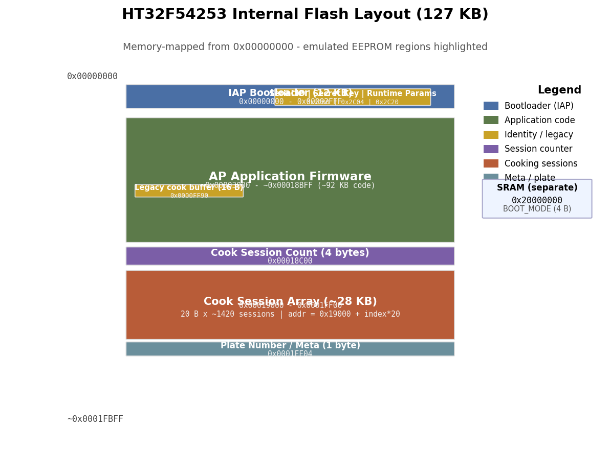
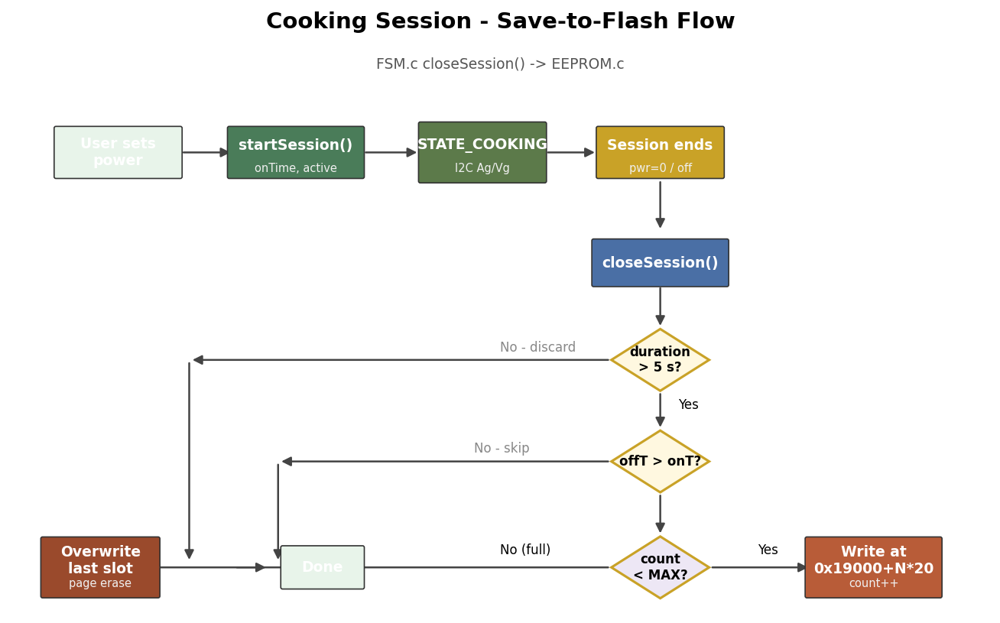
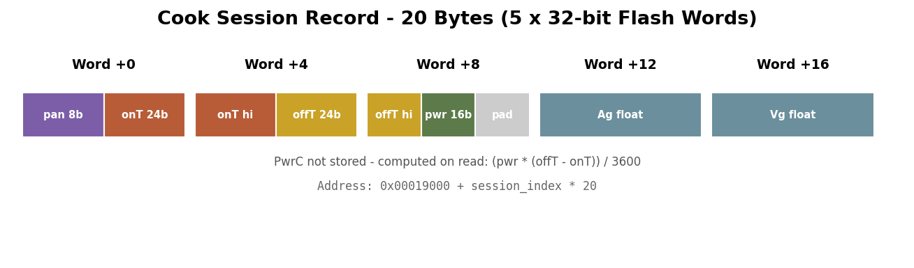
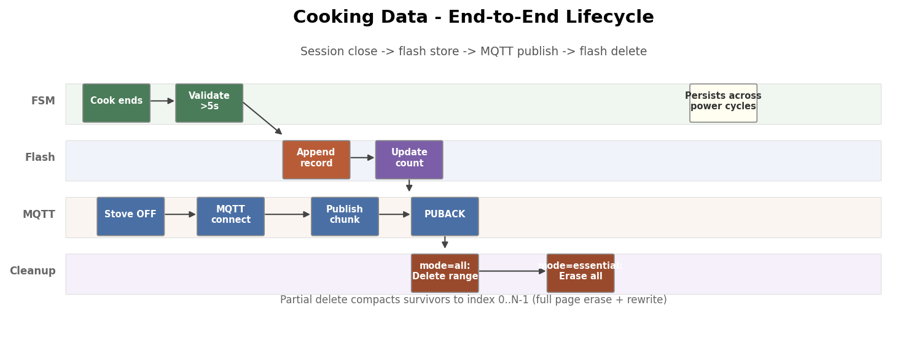

# eCOOK 3.0

**FIRMWARE SPECIFICATION DOCUMENT**

_Branch: eC3_113_enhancement  |  Version: 1.1.3  |  Doc Rev: 1.1.3_

_ATEC Global  –  Confidential  |  Date: June 2026_

| Document Title | eCOOK3 Firmware Specification |
| --- | --- |
| Version | 1.1.3 |
| Repository | github.com/atecglobal/eCOOK3_firmware_OTA |
| Target MCU | Holtek HT32F54253 (ARM Cortex-M0+) |
| Compiler | ARM MDK V5.06 update 7 (build 960) |
| IDE | Keil µVision 5 |
| Classification | Confidential |

## 1. Document Control

Release history and shipped hex files are recorded in [CHANGELOG.md](CHANGELOG.md). This specification describes firmware behaviour for version 1.1.3.

## 2. Executive Summary

The eCOOK 3.0 firmware operates on the Holtek HT32F54253 ARM Cortex-M0+ microcontroller and manages all aspects of the eCOOK smart electric cooking stove. The firmware is structured as a dual-image architecture comprising an In-Application Programming (IAP) bootloader and the main Application (AP) firmware, enabling secure over-the-air (OTA) firmware updates via cellular connectivity.

The system communicates with a cloud backend via MQTT over AWS IoT Core, using a SIMCom A7682E Cat-1 LTE GSM module for cellular data. It supports both single-plate and dual-plate stove configurations, capacitive touch key input, 7-segment LED display output, real-time cooking session tracking with persistent storage in emulated EEPROM (internal flash; see Sections 3.4 and 6.2–6.6), and comprehensive remote device management through an OTA command framework.

## 3. System Architecture Overview

### 3.1 Hardware Platform

| Component | Part / Spec | Role |
| --- | --- | --- |
| Main MCU | Holtek HT32F54253 | ARM Cortex-M0+, 128 KB Flash, 16 KB SRAM |
| GSM Module | SIMCom A7682E | Cat-1 LTE modem, MQTT client, HTTP, FOTA |
| User Input | Capacitive Touch Keys | 24-key touch panel via Holtek Touch Key Library |
| Display | LEDC 7-Segment + LEDs | 4-digit 7-segment, red indicator LEDs, 2x RGB LEDs |
| Power Boards | I2C Slave (Left/Right) | Induction power stage control + sensor readback |
| Battery | LiFePO4 (monitored via ADC) | Backup power for MCU, voltage monitored on PA7 |
| Audio | Piezo Buzzer | User feedback beeps and alerts |
| RTC | Internal LSE 32.768 kHz | Timekeeping, epoch sync, cooking timers |

### 3.2 Dual-Image Flash Memory Layout

The 128 KB internal flash is partitioned between the IAP bootloader and the main application firmware. An SRAM boot-mode flag at address 0x20000000 selects which image runs after reset.

| Region | Address Range | Description |
| --- | --- | --- |
| IAP Bootloader | 0x00000000 – 0x00002FFF | 12 KB bootloader with OTA flash-programming logic |
| AP Application | 0x00003000 – 0x00017FFF | Main application firmware (~92 KB) |
| Serial ID | 0x00002C00 | 4-byte device serial number |
| Secret Key | 0x00002C04 | Device authentication key |
| Runtime Params | 0x00002C20 | Persistent runtime parameters (RuntimeParams struct) |
| Cook Session Count | 0x00018C00 | Number of stored cooking sessions (4 bytes) |
| Cook Session Store | 0x00019000 – 0x0001FF00 | Cooking session array (20 bytes each; see Section 6) |
| Meta/Plate Config | 0x0001FF04 | Plate number and device meta information |
| Legacy Cook Buffer | 0x0000FF90 | 16-byte legacy emulated-EEPROM slot (superseded by session array) |

<p align="center">
  
</p>

*Figure 3-1: HT32F54253 internal flash map showing IAP/AP code regions and persistent emulated-EEPROM data areas (source: `EEPROM.h`, `ht32_board_config.h`). Diagrams are stored as PNG under `docs/images/` (regenerate: `python docs/images/generate_diagrams.py`).*

> Full persistent-memory mechanics (flash programming rules, runtime params, identity storage) are documented in Section 3.4. Cooking session append, erase, and MQTT-driven deletion are documented in Sections 6.2–6.6.

### 3.3 SRAM Boot Mode Mechanism

The first 4 bytes of SRAM (0x20000000) hold a boot mode flag that persists across soft resets (NVIC_SystemReset). The IAP bootloader reads this value on startup to decide whether to enter programming mode or jump to the application.

| Boot Mode Flag | Value | Action |
| --- | --- | --- |
| BOOT_MODE_AP | 0x55AAFAF0 | Jump directly to Application at 0x00003000 |
| BOOT_MODE_IAP | 0x55AAFAF5 | Enter IAP bootloader programming mode |

### 3.4 Persistent Memory Architecture (Emulated EEPROM)

The firmware does not use an external EEPROM IC. All non-volatile application data is stored in **internal flash** via the emulated-EEPROM layer implemented in `EEPROM.c`. Flash is memory-mapped and read with the `rw(addr)` macro (`*((u32 volatile *)(addr))`), which performs a direct 32-bit load from the given address. Writes use the Holtek flash driver (`FLASH_ProgramWordData`) and must respect NOR-flash rules: bits can only be programmed from `1 → 0` without an erase; erased cells read as `0xFFFFFFFF`.

#### 3.4.1 Flash Programming Constraints

| Constraint | Detail |
| --- | --- |
| Word alignment | All flash program operations are 32-bit (4-byte) aligned |
| Page size | 1024 bytes (`FLASH_PAGE_SIZE` / `LIBCFG_FLASH_PAGESIZE`) |
| Erased state | `0xFFFFFFFF` per 32-bit word |
| In-place update | Changing a programmed word from `0 → 1` requires a **page erase** |
| Page-preserving update | Read entire 1 KB page → modify buffer → erase page → write back (`memory_utils.c`, session-counter update, runtime-params update, last-slot overwrite) |

The utility `Memory_EraseFromAddress()` (`memory_utils.c`) erases a word-aligned sub-range within a single flash page while preserving the rest of the page content using the same read-modify-erase-write pattern.

#### 3.4.2 Persistent Data Region Map

All addresses are defined in `EEPROM.h`. Source constants use the `EEPROM.h` symbol names.

| Symbol / Region | Address | Size | Content |
| --- | --- | --- | --- |
| `SERIAL_ID_ADDRESS` | 0x00002C00 | 4 bytes | Device serial number (`uint32_t`) |
| `SECRET_KEY_ADDRESS` | 0x00002C04 | 16 bytes | Device authentication key (4 flash words, byte-packed) |
| `RUNTIME_PARAMS_ADDRESS` | 0x00002C20 | `sizeof(RuntimeParams)` | Persistent runtime parameters (`g_params`) |
| `EEPROM_Address` (legacy) | 0x0000FF90 | 16 bytes (4 words) | Legacy cook buffer via `Emulated_EEPROM_Write()` |
| `NUMBER_COOKING_SESSIONS_ADDRESS` | 0x00018C00 | 4 bytes | Cooking session count (`int32_t`) |
| `COOK_SESSION_BASE_ADDR` | 0x00019000 | 20 bytes × N | Dense array of cooking session records |
| `COOK_SESSION_MAX_ADDR` | 0x0001FF00 | — | Last valid byte of the session store |
| `PLATE_NUMBER_ADDRESS` | 0x0001FF04 | 1 byte | Number of plates (meta / device config) |

**Notes:**

- Serial ID, secret key, and runtime parameters reside in the low flash region (within or adjacent to the IAP/AP boundary). Compile-time `#error` guards in `EEPROM.h` prevent `RUNTIME_PARAMS_ADDRESS` from overlapping serial ID or secret key.
- The cooking session store occupies the **high end** of flash (`0x00018C00`–`0x0001FF04`), separate from the AP code region starting at `0x00003000`.
- On HT32F54253, total internal flash is 127 KB (127 × 1024 bytes). Valid flash addresses are below `0x20000000` (`INTERNAL_FLASH_MAX_ADDR` in `memory_utils.h`).
- External SPI flash is **not** used for application data (`EXT_FLASH_ENABLE = 0` in `iap_config.h`).

#### 3.4.3 Runtime Parameters in Flash

The `RuntimeParams` structure (`Utils.h`) is mirrored in RAM as `g_params` and persisted at `RUNTIME_PARAMS_ADDRESS`. On boot, `main.c` calls `Emulated_EEPROM_Read_RuntimeParams()` to load flash into RAM. OTA `pu` / `rd` commands and FSM parameter changes call `Emulated_EEPROM_Write_RuntimeParams()`.

| Field | Type | Default | Purpose |
| --- | --- | --- | --- |
| keep_alive_s | int | 600 | MQTT keep-alive interval |
| payload_mode | PayloadMode | PAYLOAD_ALL | Full vs essential cooking payloads |
| conn_strategy | ConnStrategy | CONN_ON_DEMAND | Connection FSM mode |
| max_power_w | int | 10 | Load-balancer power cap |
| meta_payload_interval_s | int | 86400 | Meta payload interval |
| send_cooking_sessions | bool | true | Enable cooking session transmission |
| send_error_payloads | bool | true | Enable error payloads |
| send_meta_payloads | bool | true | Enable meta payloads |
| lb_cap_until_epoch | uint32_t | — | Load-balancer cap expiry |
| persistent_flag | int | 0 | MQTT persistent session flag |
| num_cooking_blocks | int | 2 | Sessions per MQTT chunk (1–10) |

**Write behaviour:** the struct is cast to `uint32_t *` and written word-by-word. If any word must change from a programmed value to a value requiring `0 → 1` bit flips, the firmware performs a full page read-modify-erase-write on the containing 1 KB page. On read, words equal to `0xFFFFFFFF` are skipped so defaults remain in RAM for uninitialised slots.

#### 3.4.4 Device Identity Storage

| Item | Write API | Read API |
| --- | --- | --- |
| Serial ID | `Emulated_EEPROM_Write_Serial_ID()` | `Emulated_EEPROM_Read_Serial_ID()` |
| Secret key | Factory CLI provisioning | `Emulated_EEPROM_Read_Secret_Key()` (returns 32-char hex string) |
| Plate count | `Emulated_EEPROM_Write_Plate_Number()` | `Emulated_EEPROM_Read_Plate_Number()` |

## 4. Peripheral Configuration & Pin Assignments

### 4.1 Communication Interfaces

| Peripheral | Pins | Baud / Speed | Function |
| --- | --- | --- | --- |
| UART0 | System default | 115200 (to GSM) | AT commands to/from A7682E GSM module |
| USART1 | System default | 115200 | CLI / debug / factory mode serial console |
| I2C0 (Slave) | PC8 (SCL), PC9 (SDA) | 100 kHz | Left power board communication (addr 0x50) |
| I2C1 (Slave) | PB7 (SCL), PB8 (SDA) | 100 kHz | Right power board communication (addr 0x50) |

### 4.2 GPIO Assignments

| Pin | Direction | Function |
| --- | --- | --- |
| PB3 | Output | GSM PWRKEY – pulse high to power on A7682E |
| PB6 | Input | GSM STATUS – active-low, indicates modem power state |
| PB13 | Output | Power board enable (Left) – PWM-like on/off cycling |
| PB14 | Output | Power board enable (Right) – PWM-like on/off cycling |
| PB2 | Input | Stove on/off status detection from power board |
| PA7 | Analog Input | Battery voltage ADC (ADC_CH_9) |
| PD0 | Input | Battery charging status (CHG pin) |
| PC4–PC7, PA8–PA15, PB0–PB5, PB15, PC0–PC3 | Touch | 24 capacitive touch key channels |

### 4.3 Timer & Interrupt Architecture

The firmware uses a priority-based interrupt scheme. UART0 has highest priority (0) for reliable GSM communication, while I2C and base timer interrupts run at priority 1, and general-purpose timers, USART1, RTC, and ADC at priority 2.

| Peripheral | Priority | Purpose |
| --- | --- | --- |
| UART0_IRQn | 0 (Highest) | GSM module serial data reception |
| I2C0_IRQn / I2C1_IRQn | 1 | Power board I2C slave data exchange |
| BFTM0_IRQn / BFTM1_IRQn | 1 | 1 ms system tick, I2C polling, delay timing |
| GPTM0_IRQn | 2 | Touch key scanning, event processing timer |
| USART1_IRQn | 2 | Debug CLI serial reception |
| RTC_IRQn | 2 | Real-time clock second tick |
| ADC_IRQn | 2 | Battery voltage ADC end-of-conversion |

## 5. Finite State Machine (FSM)

The firmware operates through a well-defined FSM with 10 states. State transitions are driven by touch key events, timer expirations, power board status, and remote OTA commands. The FSM is implemented in FSM.c with a central handleEvent() dispatcher.

### 5.1 State Definitions

| State | Enum Value | Description |
| --- | --- | --- |
| STATE_ONOFF | 0 | Standby / power-off state. Display off, GSM in deep sleep (CSCLK=2). Wakes on power board connect or touch. |
| STATE_IDLE | 1 | Double-stove only: powered on, no pan selected yet. Awaiting plate selection. |
| STATE_COOKING | 2 | Active cooking. Power level displayed, I2C commands sent to power board, session recording active. |
| STATE_ERROR | 3 | Error condition detected from power board (error codes 0–7 in I2C_Rx_Data[2]). |
| STATE_FACTORY | 4 | Factory / diagnostic mode. GSM bridge mode or CLI serial console active. 5-min I2C timeout. |
| STATE_LOCK | 5 | Child lock engaged. Touch keys disabled except unlock sequence. Cooking continues. |
| STATE_SYNC | 6 | Connectivity sync display. Shows connection status for 2.5 seconds then returns. |
| STATE_PAYGO | 7 | Pay-as-you-go placeholder state (reserved for future PAYGO functionality). |
| STATE_TIMER | 8 | Timer digit entry mode. User enters countdown time via numeric touch keys. |
| STATE_COUNTDOWN | 9 | Active countdown. 7-segment shows remaining mm:ss. Auto-shutoff at 00:00. |

### 5.2 Touch Key Event Map

| Event | ID | Action |
| --- | --- | --- |
| EVENT_ONOFF_KEY | 17 | Toggle between STATE_ONOFF and active states |
| EVENT_KEY_PRESS_0–9 | 3–12 | Set power level 0–9 or enter timer digits |
| EVENT_BOOST_KEY | 13 | Enable/disable boost mode (power level 10 / 1650W) |
| EVENT_TIMER_KEY | 16 | Enter timer digit entry mode |
| EVENT_LOCK_KEY | 15 | Engage/disengage child lock |
| EVENT_SYNC_KEY | 1 | Trigger MQTT connect check and display sync status |
| EVENT_L_PLATE_SELECT_KEY | 2 | Select left plate (double stove) |
| EVENT_R_PLATE_SELECT_KEY | 14 | Select right plate (double stove) |
| EVENT_LOCK_KEY_LONG | 20 | Long-press lock – alternative lock toggle |
| EVENT_BOOST_KEY_LONG | 22 | Long-press boost |

## 6. Cooking Session Management

### 6.1 Session Lifecycle

Each cooking plate (left 'L' and right 'R') maintains an independent CookingSession structure. Sessions are started when a non-zero power level is set and closed when power returns to zero, the stove is turned off, or the timer expires. Sessions shorter than 5 seconds are discarded.

Each session records: plate identifier (L/R), start time (onTime), end time (offTime), power level, and running averages of grid current (Ag) and grid voltage (Vg). Sessions are written to emulated EEPROM in flash for persistence across power cycles. See Sections 3.4 and 6.2–6.6 for flash layout and storage mechanics.

<p align="center">
  
</p>

*Figure 6-1: Decision flow when a cooking session ends (`closeSession()` in `FSM.c`) — validation gates, append vs last-slot overwrite, and flash write targets.*

### 6.2 Flash Storage Regions

Cooking data uses two dedicated flash areas managed as a **dense indexed array** (not a linked list or circular log):

| Region | Address | Role |
| --- | --- | --- |
| Session counter | `0x00018C00` (`NUMBER_COOKING_SESSIONS_ADDRESS`) | `int32_t` count of valid sessions (indices `0 .. count−1`) |
| Session array | `0x00019000` – `0x0001FF00` | Fixed 20-byte records |

**Capacity:**

| Constant | Value |
| --- | --- |
| `COOK_SESSION_SIZE` | 20 bytes (5 × 32-bit flash words) |
| `COOK_SESSION_MAX_COUNT` | ~1420 sessions |
| Address formula | `COOK_SESSION_FLASH_ADDR(index) = 0x00019000 + index × 20` |

The counter and session array are in **different flash pages**. Erasing session data does not automatically erase the counter page; the count is explicitly rewritten to `0` (or the new remaining count) after erase/compaction.

### 6.3 Session Record Layout (20-Byte Bit Packing)

Each session is **not** stored as a C struct in flash. Fields are manually packed into five 32-bit words in `Emulated_EEPROM_Write_Cook_Session()` and unpacked in `Emulated_EEPROM_Read_Cook_Session()`:

| Word offset | Bit layout | Field |
| --- | --- | --- |
| +0 | [7:0] | `pan` (plate identifier, e.g. `'L'` / `'R'`) |
| +0 | [31:8] | `onT` bits [23:0] |
| +4 | [7:0] | `onT` bits [31:24] |
| +4 | [31:8] | `offT` bits [23:0] |
| +8 | [7:0] | `offT` bits [31:24] |
| +8 | [31:8] | `pwr` (uint16_t power level index) |
| +12 | [31:0] | `Ag` (float, IEEE-754 raw bits via `memcpy`) |
| +16 | [31:0] | `Vg` (float, IEEE-754 raw bits via `memcpy`) |

`PwrC` is **not** stored in flash; it is derived on read:

`PwrC = (pwr × (offT − onT)) / 3600.0`

The in-RAM `CookSession` struct (`EEPROM.h`) also includes `PwrC` for convenience but only the packed fields above are persisted.

<p align="center">
  
</p>

*Figure 6-3: Five flash words per session — bit fields packed manually (not stored as a C struct).*

### 6.4 Append Mechanism

Appending occurs in `closeSession()` (`FSM.c`) when a cooking session ends and passes the save filters (Section 6.1). The append algorithm is index-based:

```
count ← Emulated_EEPROM_Read_Cooking_Session_Num()
if count < COOK_SESSION_MAX_COUNT:
    Emulated_EEPROM_Write_Cook_Session(count, pan, onT, offT, pwr, Ag, Vg)
    Emulated_EEPROM_Write_Cooking_Session_Num(count + 1)
else:
    Emulated_EEPROM_Overwrite_Last_Cook_Session(...)   // count unchanged
```

**Example addressing:**

| Event | Count before → after | Flash address of new record |
| --- | --- | --- |
| 1st session saved | 0 → 1 | `0x00019000` |
| 2nd session saved | 1 → 2 | `0x00019014` |
| 3rd session saved | 2 → 3 | `0x00019028` |

#### 6.4.1 Normal append (capacity available)

1. Read `sess_count` from `0x00018C00`.
2. Program five words at `COOK_SESSION_BASE_ADDR + sess_count × 20` via `FLASH_ProgramWordData`.
3. Increment counter to `sess_count + 1`.

No page erase is required because each new slot is **virgin erased flash** (`0xFFFFFFFF`). Flash programming only clears bits (`1 → 0`).

#### 6.4.2 Store full — last-slot overwrite

When `sess_count >= COOK_SESSION_MAX_COUNT`:

- The counter **does not** increment.
- Index `COOK_SESSION_MAX_COUNT − 1` (last slot) is replaced.
- `Emulated_EEPROM_Overwrite_Last_Cook_Session()` must erase the containing 1 KB flash page first (the slot was already programmed), then restore all other words on that page, then write the new session.

This behaves as a **fixed-size buffer**: when full, the newest session replaces the record at the highest index; older sessions at lower indices are retained.

#### 6.4.3 Session counter update

`Emulated_EEPROM_Write_Cooking_Session_Num()` updates the word at `0x00018C00`:

- If the current value is `0xFFFFFFFF`, program the new count directly.
- Otherwise, perform read-modify-write on the entire 1 KB page containing the counter.

On boot, `intializeCookNum()` (`main.c`) normalises invalid counts: `−1` (erased flash interpreted as signed) → `0`; values above `COOK_SESSION_MAX_COUNT` → clamped to max.

### 6.5 Erase and Delete Mechanisms

Three erase paths exist in `EEPROM.c`. All physical erasure of session data is performed by `erase_cook_sessions_flash()`, which erases every 1 KB page from the first page at `COOK_SESSION_BASE_ADDR` through the last page at `COOK_SESSION_MAX_ADDR`, then sets the session count to `0` via `Emulated_EEPROM_Write_Cooking_Session_Num(0)`.

#### 6.5.1 Full erase — `Emulated_EEPROM_Erase_All_Cook_Sessions()`

**Triggers:**

| Source | Condition |
| --- | --- |
| CLI | Factory command `e` (`cli.c`) |
| MQTT ACK | `payloadMode = essential` — all sessions deleted after successful publish (`Payload.c`) |
| Internal | Called by partial-delete and failure-recovery paths before rewrite |

**Steps:**

1. Log each stored session (debug `printf` via `[COOK]` tags).
2. Erase all session flash pages (`0x00019000`–`0x0001FF00` page range).
3. Set session count to `0`.

#### 6.5.2 Partial delete — `Emulated_EEPROM_Delete_Cook_Sessions_Range(start_index, count)`

**Trigger:** MQTT publish ACK in `payloadMode = all` — deletes only the chunk that was successfully uploaded (`last_cook_chunk_offset`, `last_cook_chunk_size` in `Payload.c`).

**Algorithm (compact-and-rewrite, not in-place hole punch):**

```
1. Read total session count
2. If deleting all remaining → full erase (Section 6.5.1)
3. Else:
   a. Read all sessions EXCEPT [start_index, start_index + count) into RAM
   b. Full erase of session flash pages
   c. Rewrite survivors at indices 0, 1, 2, … (compacted)
   d. Set count = remaining
```

Partial delete always wipes the **entire** session flash region and rewrites a compacted array. This is required because NOR flash cannot clear individual programmed words without a page erase.

`adjust_failed_offsets_after_delete()` in `Payload.c` updates retry offset tracking after a successful chunked delete.

#### 6.5.3 Failure recovery — `storeFailedEraseRest()` (`Payload.c`)

When publish retries fail for specific chunks, this function:

1. Reads only the **failed chunk sessions** from flash into RAM.
2. Performs a full session flash erase.
3. Rewrites those sessions starting at index `0`.
4. Sets count to the number of restored sessions.

If `totalBlocks > COOK_SESSION_MAX_COUNT`, the function aborts without erasing to avoid discarding sessions.

### 6.6 Post-Upload Flash Management (MQTT Integration)

Cooking sessions are uploaded in chunks of `g_params.num_cooking_blocks` (default 2) via `sendCookingSessionsChunk(offset)` (`Payload.c`). On MQTT PUBACK (`handleCookPublishAcked()`):

| `payloadMode` | Flash action after ACK |
| --- | --- |
| `all` | `Emulated_EEPROM_Delete_Cook_Sessions_Range(offset, chunkSize)` — remove only the ACKed chunk and compact |
| `essential` | `Emulated_EEPROM_Erase_All_Cook_Sessions()` — aggregated payload sent; all per-session records cleared |

If MQTT is not ready when an ACK is processed, blocks are **kept in flash** (logged: `Cook ACK ignored: MQTT not ready`).

<p align="center">
  
</p>

*Figure 6-2: End-to-end lifecycle — session close and flash append, MQTT chunked publish and PUBACK, then flash deletion (`payloadMode = all` partial compact delete vs `essential` full erase). Manual erase via CLI command `e` is also shown.*

### 6.7 Power Level Mapping

| Level | Single Stove (W) | Double Stove (W) | Notes |
| --- | --- | --- | --- |
| 0 | 0 | 0 | Off |
| 1 | 300 | 300 |  |
| 2 | 400 | 400 |  |
| 3 | 600 | 500 |  |
| 4 | 700 | 600 |  |
| 5 | 900 | 700 |  |
| 6 | 1100 | 800 |  |
| 7 | 1300 | 860 |  |
| 8 | 1500 | 940 |  |
| 9 | 1600 | 1000 | Max non-boost |
| 10 (Boost) | 0 (N/A) | 1650 | Boost mode, double stove only |

## 7. I2C Power Board Communication

### 7.1 Protocol

The MCU acts as I2C slave (address 0x50) on both I2C0 and I2C1 channels. The power boards act as masters, polling the MCU for commands and sending sensor data back. I2C slave receive is polled every 1 ms from the BFTM0 interrupt handler to minimize display update latency.

### 7.2 TX Data Frame (MCU → Power Board)

| Byte | Field | Values | Description |
| --- | --- | --- | --- |
| [0] | Plate Config | 1=Left, 2=Right, 3=Single | Identifies which plate this command targets |
| [1] | Power Level | 0–10 | Desired power level |
| [2] | Reserved | 0x00 | Temperature setting (future use) |
| [3] | CRC High | Calculated | CRC-16 high byte over bytes [0..2] |
| [4] | CRC Low | Calculated | CRC-16 low byte over bytes [0..2] |
| [5–7] | Reserved | 0x00 | Future expansion |

### 7.3 RX Data Frame (Power Board → MCU)

| Byte | Field | Type | Description |
| --- | --- | --- | --- |
| [0] | Manufacturer Code | uint8 | Power board manufacturer ID |
| [1] | Plate Config | uint8 | 1=Double left, 2=Double right, 3=Single |
| [2] | Error Code | uint8 | 0–7: error codes, 8: no error |
| [3–4] | Grid Voltage (Vg) | uint16 BE | Raw grid voltage reading |
| [5] | Grid Current Low | uint8 | Current low byte (combined with [13]) |
| [11–12] | CRC | uint16 BE | CRC-16 over bytes [0..10] |
| [13] | Grid Current High | uint8 | Current high byte: Ag = ([13]<<8 \| [5]) / 256.0 |
| [15] | Checksum | uint8 | Simple sum of bytes [0..14] |

### 7.4 Mains Power Detection

When external mains power is removed, all four I2C GPIO lines (PC8, PC9, PB7, PB8) go high. The firmware monitors these lines and if all remain high for 1000+ consecutive main-loop iterations, the turnOff flag is set, triggering a graceful shutdown to STATE_ONOFF with session closure and GSM deep sleep.

## 8. Electrical Measurement & Stove Statistics

### 8.1 Running Average Algorithm

The stove_stats module (stove_stats.c) implements a streaming running-average algorithm for grid current (Ag), grid voltage (Vg), and instantaneous power (Pg = Ag × Vg). Samples are fed via pg_accept_sample() from the main loop whenever CRC-validated I2C data is available.

Input filtering rejects samples outside valid ranges: Vg must be 200–300V, Ag must be 0.05–20A. A repair heuristic detects missing-decimal current values (e.g., 3449219 is corrected to 3.449219A). The computed averages are written directly to globalPayload.stat for inclusion in MQTT telemetry.

### 8.2 Battery Monitoring

Battery voltage is measured via the HT32F54253 internal ADC on channel 9 (PA7) in continuous conversion mode. The charging status is read from PD0 (active-low CHG pin). Battery data is reported in the meta payload as a combined string: voltage + charging flag (e.g., "3.85X1" means 3.85V, charging).

## 9. GSM Module & MQTT Communication

### 9.1 GSM Power Management

The A7682E is powered on by pulsing PB3 (PWRKEY) high. Power state is monitored via PB6 (STATUS, active-low). The module supports deep sleep via AT+CSCLK=2, which is enabled whenever the stove enters STATE_ONOFF to conserve power. The module is woken by sending AT commands on UART0.

### 9.2 MQTT Connection to AWS IoT Core

The firmware publishes telemetry data to the MQTT topic "usage-raw-data-topic-prod" using the SIMCom AT+CMQTT command set. QoS 1 is used for reliable delivery. Connection management follows the configured connection strategy:

| Strategy | Enum | Behavior |
| --- | --- | --- |
| Always On | CONN_ALWAYS_ON (0) | MQTT stays connected permanently. Keep-alive pings at configurable interval. |
| On Demand | CONN_ON_DEMAND (1) | Connect only to transmit data, then disconnect and sleep. Default mode. |
| Once | CONN_ONCE (2) | Connect once per power cycle, transmit, then disconnect. |

### 9.3 Epoch Time Synchronisation

The firmware synchronises its epoch time using the GSM module’s AT+CLBS (Cell Location Based Service) command. It fetches the network time with up to 5 modem attempts per session, with 60-second delays between attempts. Successful sync is re-validated every 24 hours. If CLBS fails after all attempts, device_time (seconds since boot) is used as fallback. Epoch validity is checked against the range Jan 1, 2025 to Jan 1, 2100.

### 9.4 ICCID & Geolocation

The SIM ICCID is retrieved via AT+ICCID and stored as the device SID (subscriber ID). GPS coordinates are obtained via AT+CLBS and stored as latitude,longitude in the device identity payload. Both are retried every 5 seconds until successful.

## 10. OTA Command Framework

### 10.1 Command Protocol

The device receives JSON-formatted commands via MQTT subscription. Commands arrive on UART0 from the GSM module and are parsed by a circular-buffer JSON extractor in the main loop (`process_uart_json_messages`). Each command has the structure:

{"ty":"<command>","cid":<correlation_id>, ... command-specific fields ... }

The JSON framer captures from the first `{` to the first `}` in the stream and does not track brace nesting. Commands must therefore be sent as a **single flat JSON object** — nested objects (e.g. a `"data":{...}` block) are truncated at the inner `}` and rejected by the parser. All command-specific fields (including every `pu` parameter) are read from the top level of the object; the `data` field, where used, must be a string or number, never an object.

Constraints:

- `ty` must be a string and `cid` must be a number, or the message is ignored.
- Duplicate commands (same `cid` as the previous one) are rejected (`last_cid` guard).
- Max accepted message length is 320 bytes (`MAX_JSON_SIZE`); up to 3 messages are processed per main-loop pass.

Every command publishes an acknowledgement to topic `resp/<serial_number>` containing at least `{"cid":<id>,"ok":<bool>,"sid":<serial>}`. For `pu` and `rp` the response also embeds the full current parameter set under `params`.

### 10.2 Supported Commands

| Command | Type Code | Parameters | Description |
| --- | --- | --- | --- |
| Firmware Update | fw | data: URL string, xapi: 0\|1 | Triggers HTTP download of .hex firmware file to GSM filesystem, then reboots into IAP for flashing |
| FOTA Update | fota | data: URL, usr, pwd | Triggers GSM module native FOTA via AT+CFOTA |
| Parameter Update | pu | keepAlive, payloadMode, connStrategy, etc. | Updates runtime parameters and persists to EEPROM |
| Load Balancer | lb | maxPower: 0–10, duration: seconds | Caps maximum power level. Immediately clamps running plates. |
| Shutoff | so | None | Immediate remote stove shutoff |
| Meta Request | mr | None | Forces immediate transmission of 24-hour meta payload |
| Reset Defaults | rd | None | Resets all runtime parameters to factory defaults |
| Read Params | rp | None | Re-reads runtime parameters from EEPROM |
| PayGo | pg | None | Placeholder for future pay-as-you-go functionality |

### 10.3 Runtime Parameters (pu command)

The pu command can update any combination of the following parameters. Changes are persisted to flash at address 0x00002C20 via Emulated_EEPROM_Write_RuntimeParams().

| Parameter | JSON Key | Default | Description |
| --- | --- | --- | --- |
| Keep Alive | keepAlive | 600s | MQTT keep-alive interval (10–86400 seconds) |
| Payload Mode | payloadMode | all | "all": full session data, "essential": aggregated only |
| Connection Strategy | connStrategy | on_demand | "always_on", "on_demand", or "once" |
| Send Cooking Sessions | sendCookingSessions | true | Enable/disable cooking session payload transmission |
| Send Errors | sendErrors | true | Enable/disable error payload transmission |
| Send Meta | sendMeta | true | Enable/disable meta payload transmission |
| Meta Interval | metaIntervalS | 86400s | Interval between meta payloads (1–86400 seconds) |
| Persistent Flag | persistentFlag | 0 | 0 or 1, controls persistent connection behavior |
| Num Cooking Blocks | numCookBlock | 2 | Number of cooking session blocks per payload (1–10) |

### 10.4 OTA Command Examples

All examples are shown pretty-printed; transmit them as a single-line flat object. Replace `<cid>` with a fresh correlation id on every send (a repeated `cid` is ignored).

#### 10.4.1 Firmware Update (`fw`)

Downloads a `.hex` over HTTP and reboots into IAP to flash it. `xapi:1` adds the `X-API-Key` header during download.

```json
{"ty":"fw","cid":101,"data":"https://example.com/fw/eCook3_OTA_TEST1.hex","xapi":0}
```

#### 10.4.2 GSM FOTA Update (`fota`)

Triggers the A7682E native FOTA via `AT+CFOTA=0,1,"<url>","<usr>","<pwd>"`. `usr`/`pwd` are optional (default empty).

```json
{"ty":"fota","cid":102,"data":"https://example.com/fota/delta.bin","usr":"otauser","pwd":"otapass"}
```

#### 10.4.3 Parameter Update (`pu`)

Updates one or more runtime parameters; all are optional and applied together. Parameters are top-level keys (NOT nested in `data`). Persisted to flash only when at least one valid parameter is applied.

Single parameter (number of cooking session blocks per payload, 1–10):

```json
{"ty":"pu","cid":103,"numCookBlock":5}
```

Multiple parameters at once:

```json
{"ty":"pu","cid":104,"keepAlive":600,"payloadMode":"all","connStrategy":"on_demand","metaIntervalS":86400,"persistentFlag":0,"sendCookingSessions":true,"sendErrors":true,"sendMeta":true,"numCookBlock":2}
```

Accepted keys, types and ranges:

| JSON Key | Type | Accepted Values | Notes |
| --- | --- | --- | --- |
| keepAlive | int | 10 – 86400 | MQTT keep-alive seconds |
| payloadMode | string | "all", "essential" | Full vs aggregated cooking payload |
| connStrategy | string | "always_on", "on_demand", "once" | Connection FSM mode |
| metaIntervalS | int | 1 – 86400 | Meta payload interval (seconds) |
| metaFreqHz | number | (0, 10] | Alternative to metaIntervalS; interval = 1/Hz (min 100 ms) |
| persistentFlag | int | 0, 1 | MQTT clean/persistent session flag |
| sendCookingSessions | bool | true/false, 1/0, "true"/"false" | Enable cooking payloads |
| sendErrors | bool | true/false, 1/0 | Enable error payloads |
| sendMeta | bool | true/false, 1/0 | Enable meta payloads |
| numCookBlock | int | 1 – 10 | Cooking session blocks per payload (default 2) |

> A `numCookBlock` change applied mid-upload takes effect on the next drain cycle; the in-progress cycle keeps its snapshotted block size.

#### 10.4.4 Load Balancer / Max Power (`lb`)

Caps the maximum power level (0–10) and immediately clamps any running plate. `duration` (seconds) is optional; if omitted or 0, the default load-balancer duration (60 s) is applied.

```json
{"ty":"lb","cid":105,"maxPower":6,"duration":3600}
```

The cap may also be sent directly in `data` as an integer:

```json
{"ty":"lb","cid":106,"data":5}
```

#### 10.4.5 Remote Shutoff (`so`)

Immediately shuts the stove off (closes sessions, returns to STATE_ONOFF). No parameters.

```json
{"ty":"so","cid":107}
```

#### 10.4.6 Meta Request (`mr`)

Forces an immediate meta/24-hour payload transmission. No parameters.

```json
{"ty":"mr","cid":108}
```

#### 10.4.7 Reset to Defaults (`rd`)

Resets all runtime parameters to factory defaults and persists them. No parameters.

```json
{"ty":"rd","cid":109}
```

#### 10.4.8 Read Parameters (`rp`)

Re-reads runtime parameters from EEPROM and returns the full set in the response. No parameters.

```json
{"ty":"rp","cid":110}
```

#### 10.4.9 PayGo (`pg`)

Reserved placeholder; currently responds `ok:false`. No parameters.

```json
{"ty":"pg","cid":111}
```

#### 10.4.10 Parameter Response (`pu` / `rp`)

Acknowledgements for `pu` and `rp` are published to `resp/<serial_number>` with the current parameters embedded:

```json
{
  "cid": 110,
  "ok": true,
  "sid": 542530001,
  "params": {
    "ka": 600,
    "ps": 0,
    "pm": "all",
    "cs": "on_demand",
    "mp": 10,
    "mpi": 86400,
    "CEM": "1X1X1",
    "ncb": 2
  }
}
```

Response key mapping: `ka`=keepAlive, `ps`=persistentFlag, `pm`=payloadMode, `cs`=connStrategy, `mp`=maxPower, `mpi`=metaIntervalS, `CEM`=sendCookingSessions×sendErrors×sendMeta (each 1/0), `ncb`=numCookBlock.

## 11. OTA Firmware Update Process

### 11.1 HTTP-Based OTA (fw command)

The firmware update process follows a multi-stage pipeline triggered by the “fw” OTA command:

- Stage 1 – Command Reception: The “fw” JSON command is parsed and the firmware URL is stored. updateAvailable flag is set.
- Stage 2 – GSM Reset: When the stove is in STATE_ONOFF, the GSM module is reset (AT+CRESET) to ensure a clean HTTP session. A loading animation plays on the 7-segment display.
- Stage 3 – HTTP Download: After a 25-second delay, fwDownload() configures SSL (TLS 1.2, SNI enabled, RTC time ignored), initialises HTTP, sets the firmware URL, and triggers AT+HTTPACTION=0 (GET). Retries up to 5 times on failure.
- Stage 4 – File Storage: On HTTP 200, the response is saved to the GSM module filesystem via AT+HTTPREADFILE="eCook3_OTA_TEST1.hex".
- Stage 5 – IAP Reboot: BOOT_MODE is set to BOOT_MODE_IAP (0x55AAFAF5) in SRAM, and NVIC_SystemReset() is called.
- Stage 6 – Bootloader Flashing: The IAP bootloader reads the .hex file from the GSM filesystem via UART0 AT+FSREAD, parses Intel HEX records, erases the AP flash region, and programs the new firmware.
- Stage 7 – Reboot to AP: On success, BOOT_MODE is set to BOOT_MODE_AP and the device resets into the new firmware.

### 11.2 FOTA-Based OTA (fota command)

The alternative FOTA path uses the A7682E module’s native delta-update capability via AT+CFOTA. The GSM module manages the entire download and dual-reboot process autonomously. This updates the GSM module’s own firmware rather than the MCU application.

### 11.3 IAP Bootloader Security

The IAP bootloader supports ARC4 encryption for firmware images, a 64-byte command key for authentication, and digest verification of programmed data. These features are enabled via iap_config.h flags (ARC4_DECRYPTION_EN, COMMAND_KEY_EN, DIGEST_CHECK_EN). If flash has been erased but programming fails, the bootloader retries indefinitely since there is no valid AP to fall back to.

## 12. MQTT Payload Structure

All telemetry is published as compact, single-line JSON (no whitespace) built with `snprintf` in `Payload.c` — there is no heap allocation, which avoids the allocator hardfaults seen in earlier revisions. The device publishes five distinct payload types. Four of them (meta, cooking, essential/aggregated, error) are published to the primary telemetry topic; the connection-retry payload uses its own topic.

| Payload Type | Builder Function | MQTT Topic | QoS | Trigger |
| --- | --- | --- | --- | --- |
| Meta (device + stats) | `send24Hrs()` | `usage-raw-data-topic-prod` | 1 | Power-on, then every `metaIntervalS` (default 24 h) |
| Cooking session (full) | `sendCookingSessionsChunk()` | `usage-raw-data-topic-prod` | 1 | On `EVENT_OFF`, when `payloadMode = all` |
| Cooking aggregated (essential) | `sendCookingSessionsAggregated()` | `usage-raw-data-topic-prod` | 1 | On `EVENT_OFF`, when `payloadMode = essential` |
| Error | `sendMultipleErrorPayload()` | `usage-raw-data-topic-prod` | 1 | Power-board error codes detected |
| Connection retry | `sendRetryDetails()` | `device-retry-topic` | 1 | After MQTT connection retries |

> Note on formatting: numeric JSON values are emitted as raw numbers (e.g. `"ts":1748520000`), while a number of identity/status fields are intentionally emitted as quoted strings (e.g. `"sn":"542530001"`, `"BatV":"3.85X1"`). The examples below reflect the firmware output verbatim.

### 12.1 Meta Payload (device identity + 24-hour statistics)

Transmitted once on each stove power-on and periodically thereafter (`metaIntervalS`). Carries device identity, battery status and rolling usage counters. Only sent when a valid epoch (CLBS-synced) is available — see Section 9.3. Buffer size: 512 bytes.

**Format**

```json
{"devID":{"sn":"<sn>","FW":"<fw>","pt":"<plates>","mc":"<mfr>","sid":"<iccid>","loc":"<lat,lon>"},"ts":<epoch>,"stat":{"BatV":"<v>X<chg>","STL":"<conn>X<timer>X<lock>","stvcnt":"<count>"}}
```

**Fields**

| Field | JSON Type | Source | Description |
| --- | --- | --- | --- |
| devID.sn | string | EEPROM serial ID | Device serial number |
| devID.FW | string | `globalPayload.devID.FW` | Firmware version (e.g. `1.1.2`) |
| devID.pt | string | `eCooker.numberOfPlates` | Number of plates (1 = single, 2 = double) |
| devID.mc | string | `I2C_Rx_Data[0]` | Power-board manufacturer code |
| devID.sid | string | `AT+ICCID` | 20-digit SIM ICCID (subscriber ID) |
| devID.loc | string | `AT+CLBS` | Geolocation as `latitude,longitude` |
| ts | number | RTC epoch | Epoch seconds at transmission |
| stat.BatV | string | ADC + CHG pin | `<volts>X<charging>` (e.g. `3.85X1`), or `NA` if out of 0–4.2 V range |
| stat.STL | string | counters | `nconn X ntimer X nlock` — connect / timer-use / lock-use counts since last meta |
| stat.stvcnt | string | counter | Stove power-on count since last meta |

**Example**

```json
{
  "devID": {
    "sn": "542530001",
    "FW": "1.1.2",
    "pt": "2",
    "mc": "7",
    "sid": "89914012345678901234",
    "loc": "12.9716,77.5946"
  },
  "ts": 1748520000,
  "stat": {
    "BatV": "3.85X1",
    "STL": "4X2X1",
    "stvcnt": "3"
  }
}
```

After a successful publish the `nconn`, `ntimer`, `nlock` and `stvcnt` counters are reset to zero and the GSM module is placed into deep sleep (`AT+CSCLK=2`).

### 12.2 Cooking Session Payload — Full Mode (`payloadMode = all`)

Transmitted after cooking sessions complete (on `EVENT_OFF`). Stored sessions are read back from emulated EEPROM and sent in chunks of `numCookBlock` sessions per message (default 2). Records whose `pan` is neither `L` nor `R` are skipped as corrupt. Timestamps are emitted verbatim (frozen at session close via the sync anchor) so a re-send is byte-identical and the backend can deduplicate. Buffer size: 1024 bytes.

After a successful MQTT PUBACK, flash records are removed per Section 6.6: in `payloadMode = all`, only the ACKed chunk is deleted and remaining sessions are compacted; in `payloadMode = essential`, all session records are erased.

**Format**

```json
{"devID":{"sn":"<sn>","FW":"<fw>"},"ts":<epoch>,"Cook":[{"pan":"<L|R>","onT":<epoch>,"offT":<epoch>,"pwr":<watts>,"pwrC":<wh>,"Pg":<wh>}, ...]}
```

**Fields**

| Field | JSON Type | Description |
| --- | --- | --- |
| devID.sn | string | Device serial number |
| devID.FW | string | Firmware version |
| ts | number | Epoch seconds at transmission |
| Cook[].pan | string | Plate identifier: `L` (left) or `R` (right) |
| Cook[].onT | number | Session start epoch (frozen at close) |
| Cook[].offT | number | Session end epoch (frozen at close) |
| Cook[].pwr | number | Power level mapped to watts (`POWER_LEVEL[plates-1][level]`) |
| Cook[].pwrC | number | Estimated energy from configured power × duration, in Wh (capped at 3200 W single / 3300 W double) |
| Cook[].Pg | number | Integrated measured energy (Ag×Vg×dt) in Wh; falls back to `pwrC` when no measured energy is available |

**Example** (`numCookBlock = 2`)

```json
{
  "devID": {
    "sn": "542530001",
    "FW": "1.1.2"
  },
  "ts": 1748520600,
  "Cook": [
    {
      "pan": "L",
      "onT": 1748519000,
      "offT": 1748519420,
      "pwr": 900,
      "pwrC": 105.00,
      "Pg": 98.42
    },
    {
      "pan": "R",
      "onT": 1748519100,
      "offT": 1748519280,
      "pwr": 1650,
      "pwrC": 82.50,
      "Pg": 80.11
    }
  ]
}
```

### 12.3 Cooking Aggregated Payload — Essential Mode (`payloadMode = essential`)

When the device is configured for `essential` mode, individual sessions are not transmitted; instead a single rolled-up `CookAgg` summary is published, greatly reducing data volume. Buffer size: 256 bytes.

**Format**

```json
{"devID":{"sn":"<sn>","FW":"<fw>"},"ts":<epoch>,"CookAgg":{"count":<n>,"avgPwrW":<watts>,"totalSecs":<secs>,"pwrC":<wh>,"PgWh":<wh>}}
```

**Fields**

| Field | JSON Type | Description |
| --- | --- | --- |
| devID.sn | string | Device serial number |
| devID.FW | string | Firmware version |
| ts | number | Epoch seconds at transmission |
| CookAgg.count | number | Number of sessions included in the aggregate |
| CookAgg.avgPwrW | number | Average power across included sessions, in watts |
| CookAgg.totalSecs | number | Total cooking time across all sessions, in seconds |
| CookAgg.pwrC | number | Sum of configured-power energy estimates, in Wh |
| CookAgg.PgWh | number | Sum of integrated measured energy, in Wh (falls back to `pwrC` sum if zero) |

**Example**

```json
{
  "devID": {
    "sn": "542530001",
    "FW": "1.1.2"
  },
  "ts": 1748520600,
  "CookAgg": {
    "count": 5,
    "avgPwrW": 1120.00,
    "totalSecs": 2360,
    "pwrC": 734.50,
    "PgWh": 712.08
  }
}
```

### 12.4 Error Payload

Error codes reported by the power board (`I2C_Rx_Data[2]`, values 0–7) are queued and published as a batch. A 500 device-time-tick debounce prevents duplicate reports of the same error. The error array is detached under a critical section before serialisation so the producer (`addErrC()`) cannot reallocate it mid-publish. Buffer size: 768 bytes.

**Format**

```json
{"devID":{"sn":"<sn>"},"errC":[{"ts":"<epoch>","err":"<code>"}, ...]}
```

**Fields**

| Field | JSON Type | Description |
| --- | --- | --- |
| devID.sn | string | Device serial number |
| errC[].ts | string | Epoch timestamp at which the error was recorded |
| errC[].err | string | Power-board error code (`0`–`7`) |

**Example**

```json
{
  "devID": {
    "sn": "542530001"
  },
  "errC": [
    { "ts": "1748519950", "err": "3" },
    { "ts": "1748520010", "err": "5" }
  ]
}
```

### 12.5 Connection Retry Payload

Published to the dedicated `device-retry-topic` to report how many MQTT connection retries were required, aiding field connectivity diagnostics. Buffer size: 160 bytes.

**Format**

```json
{"devID":{"sn":"<sn>"},"ts":<epoch>,"retry":<count>}
```

**Fields**

| Field | JSON Type | Description |
| --- | --- | --- |
| devID.sn | string | Device serial number |
| ts | number | Epoch seconds at transmission |
| retry | number | Number of connection retry attempts (`connRetryCount`) |

**Example**

```json
{
  "devID": {
    "sn": "542530001"
  },
  "ts": 1748520000,
  "retry": 2
}
```

## 13. Display & User Interface

### 13.1 LED Controller (LEDC)

The HT32F54253’s built-in LEDC peripheral drives all visual output. The display comprises a 4-digit 7-segment display, red indicator LEDs for power levels (0–9), status LEDs for keys (Power, Timer, Lock, Boost, L-Plate, R-Plate), and two RGB LEDs (Sync and PayGo) supporting Off/Steady/Blink modes with a 300 ms blink interval.

### 13.2 Display Modes

| State | 7-Segment Shows | LED Indicators |
| --- | --- | --- |
| STATE_ONOFF | Blank (or H if hot) | All off |
| STATE_COOKING | Power level (e.g., " 5 5") | Red LED at power level, plate selection |
| STATE_COUNTDOWN | Timer mm:ss | Timer key LED on |
| STATE_LOCK | Power level | Lock key LED on |
| STATE_ERROR | Error code (E0–E7) | Depends on selected plate |
| STATE_SYNC | SYNC or ---- on fail | Sync RGB green (connected) or red blink (failed) |
| OTA Update | Loading animation | Sync RGB blue blink |
| Battery Level | Voltage (e.g., 3.85) | Shown momentarily |

### 13.3 Buzzer Feedback

Audio feedback is provided through a piezo buzzer driven via timer-based PWM. Short beeps (buzz function) indicate key presses and state changes. Long beeps (Buzzer_LongBeep) with configurable frequency and duration are used for sync completion and timer expiration alerts.

## 14. Power Management & Deep Sleep

### 14.1 Sleep Entry Sequence

When the stove enters STATE_ONOFF with no active cooking sessions, the firmware initiates a power-saving sequence:

- The GSM module is put into deep sleep via AT+CSCLK=2, reducing cellular power consumption to microamp levels.
- Power board enable pins (PB13, PB14) are deactivated.
- The LEDC display is cleared and all indicator LEDs are turned off.
- The MCU enters a reduced-activity loop, waking on I2C activity (power board connection), touch key events, or UART data.

### 14.2 Wake-Up Sources

The system exits deep sleep and returns to active operation when any of the following events occur: an I2C master (power board) connects on I2C0 or I2C1, a capacitive touch key is pressed, or UART data arrives from the GSM module (e.g., an incoming MQTT command). On wake, the GSM module is re-activated by sending AT commands on UART0, which automatically brings the modem out of CSCLK=2 sleep.

### 14.3 Auto-Shutoff Timers

An auto-shutoff mechanism in RTC.c monitors user inactivity. If no touch interaction occurs for 10 minutes while power levels are at zero, the stove automatically transitions to STATE_ONOFF. A separate 2-hour maximum cooking session duration is enforced (MAX_SESSION_DURATION_SEC = 7200) to prevent indefinite unattended cooking.

### 14.4 Power Board Enable Cycling

During active cooking states, the power board enable pins (PB13, PB14) are cycled with an ON_TIME of 200 ms and OFF_TIME of 20 ms. This PWM-like pattern is managed by the GPTM0 timer and is halted when the stove transitions to STATE_ONOFF, fully de-energising the power boards.

## 15. CLI & Factory Mode

### 15.1 Serial Command-Line Interface

The firmware includes a serial command-line interface accessible via USART1 for factory provisioning and diagnostics. Factory mode (STATE_FACTORY) is entered when no power board I2C connection is detected. Key CLI capabilities include serial number programming, secret key provisioning, stove configuration readback, and diagnostic output.

### 15.2 GSM Bridge Mode

In GSM bridge mode (isGSMbridge flag), USART1 input is forwarded directly to UART0 (GSM module), allowing direct AT command interaction with the A7682E for modem diagnostics and configuration. This mode persists until the bridge flag is cleared, enabling uninterrupted modem-level debugging.

### 15.3 Factory Mode Timeout

Factory mode uses an extended I2C lost-connection timeout of 5 minutes (IIC_LOST_CONNECT_TIMEOUT_FACTORY_MS) compared to the default 60-second timeout in normal operation, providing adequate time for factory floor provisioning workflows.

## 16. Data Integrity – CRC-16

All I2C data frames between the MCU and power boards are protected by CRC-16 checksums. The CRC is computed using a hardware-accelerated CRC peripheral on the HT32F54253 (configured in CRC.c). TX frames include CRC in bytes [3–4], and RX frames are validated against CRC in bytes [11–12] before sensor data is accepted. A configurable seed value is used for CRC initialisation.

## 17. Watchdog Timer

The firmware conditionally uses the HT32F54253 hardware watchdog timer (WDT). The watchdog is restarted (WDT_Restart()) in the main loop and at strategic points during long operations to prevent hangs. The watchdog enable state is checked via the APBCCR1 clock register bit before calling restart, allowing debug builds to run without watchdog interference.

## 19. Appendix – Source File Reference

| File | Lines | Purpose |
| --- | --- | --- |
| main.c | 851 | Entry point, main loop, peripheral init, JSON command processing |
| FSM.c / FSM.h | 1464 / 128 | State machine, event handlers, cooking session management |
| Payload.c / Payload.h | 1433 / ~90 | MQTT payload construction, publishing, connection management |
| ota_commands.c | 435 | OTA command dispatcher (fw, fota, pu, lb, so, mr, rd, rp) |
| TouchFunction.c | 1053 | Capacitive touch key scanning, deep sleep mode config |
| Utils.c / Utils.h | 970 / ~120 | GSM AT helpers, epoch sync, CLBS, battery voltage, runtime params |
| cli.c | 1238 | Serial CLI for factory provisioning and GSM bridge mode |
| LEDC.c | 728 | 7-segment display, red/RGB LEDs, loading animations |
| EEPROM.c | ~480 | Flash-emulated EEPROM: serial ID, cooking sessions (pack/append/erase), runtime params |
| memory_utils.c | ~125 | Page-preserving partial flash erase (`Memory_EraseFromAddress`) |
| RTC.c | 382 | RTC config, epoch time, auto-shutoff timer, idle detection |
| I2C0.c / I2C1.c | 296 / 278 | I2C slave communication with left/right power boards |
| stove_stats.c | ~45 | Running average computation for Ag, Vg, Pg |
| eCooker.c | ~35 | Stove configuration (single/double plate detection) |
| gsm.c | ~50 | GSM power-on pulse, status pin readback |
| buzzer.c | 163 | Piezo buzzer control, beep patterns |
| batVoltage.c | ~80 | ADC configuration for battery voltage measurement |
| IAP/main.c | ~500 | Bootloader: Intel HEX parser, flash programmer, GSM file reader |

## 20. Payload Integrity & Deduplication

This section defines the firmware-level rules that guarantee every MQTT payload transmitted by the eCOOK3 is unique, unaltered, and carries a valid timestamp. These requirements address two known data-integrity failure modes: (1) duplicate payloads produced by MQTT ring-buffer retransmission and (2) corrupted or absent session timestamps that inflate reported energy usage.

These rules are mandatory from firmware v1.1.2 onward. Any deviation must be reviewed and explicitly documented in the relevant module’s changelog.

### 20.1 Payload Uniqueness

Each outbound MQTT message must be uniquely identifiable at the firmware level before transmission. The following conditions must all be satisfied:

#### 20.1.1 Cooking Session Block ID (cbid)

- Every cooking session record written to flash must be assigned a monotonically incrementing Cooking Block ID (cbid) at the time of session close.
- The cbid is a uint32_t persisted in flash alongside the session record (20-byte session struct + 4-byte cbid extension). It is initialised from flash on boot and incremented atomically before each write.
- Before a session block is published via MQTT, Payload.c must verify that the cbid has not been transmitted in the current power cycle. A transmitted-cbid bitmap or last-transmitted-cbid value is maintained in SRAM for this purpose.
- If a duplicate cbid is detected at publish time, the block must be silently discarded and the corresponding flash slot erased. The discard event must be logged via the debug CLI (USART1) with the cbid value and reason code DUP_CBID.

#### 20.1.2 MQTT QoS-1 Retransmission Guard

- The A7682E modem retransmits unacknowledged QoS-1 messages automatically. To prevent duplicate records reaching AWS IoT Core, the firmware must not re-enqueue a session block for publication unless its cbid differs from the last successfully acknowledged block.
- MQTT PUBACK reception (AT+CMQTTPUB completion with return code 0) must set an in-SRAM acked_cbid variable. The ring buffer’s read pointer must only advance when acked_cbid matches the head cbid.
- On GSM module reset or unexpected disconnection, the ring buffer state is restored from flash. The firmware must not re-publish blocks whose cbid ≤ acked_cbid at the time of reconnection.

#### 20.1.3 Meta and Error Payload De-duplication

- Meta payloads carry a "ts" (epoch timestamp) field. Two meta payloads with identical "ts" values must not be transmitted in the same power cycle. The last-transmitted meta timestamp is stored in SRAM and compared before each scheduled transmission.
- Error payloads carry a device-time tick count. The existing 500-tick debounce threshold (Section 12.3) remains in effect; no additional cbid mechanism is required for error payloads.

### 20.2 Payload Immutability

Once a payload has been serialised in Payload.c, its content must not be modified before or during transmission. The following rules enforce immutability:

#### 20.2.1 Construction-Time Freeze

- Payload.c must serialise the full JSON string into a dedicated transmit buffer (tx_payload_buf[]) immediately upon session close, before any GSM connect sequence begins.
- The transmit buffer must be declared as a module-level static and must not be written to by any other module once the serialisation flag (payload_ready) is set to 1.
- Any runtime-parameter change received via the pu OTA command during an in-progress transmission must be deferred until the current MQTT publish cycle completes (PUBACK received or timeout expired).

#### 20.2.2 CRC Guard on Transmit Buffer

- A CRC-16 checksum of tx_payload_buf[] must be computed immediately after serialisation and stored in a companion variable (tx_payload_crc).
- Immediately before passing the buffer to the AT+CMQTTPUB command, Payload.c must recompute the CRC and compare it against tx_payload_crc. If the values differ, transmission must be aborted, the anomaly logged via USART1 with reason code BUF_CORRUPT, and the session re-serialised from the original flash record.
- This guard applies to cooking session payloads, meta payloads, and error payloads.

### 20.3 Timestamp Validity & Fallback

Every cooking session payload must carry valid epoch timestamps for session start (onT) and session end (offT). This section defines the validation rules and the mandatory fallback behaviour when valid epoch time is unavailable.

#### 20.3.1 Epoch Validity Check

- Before writing a session record to flash, FSM.c must verify that both onT and offT satisfy: 1735689600 ≤ timestamp ≤ 4102444800 (Jan 1, 2025 to Jan 1, 2100). This range is the same boundary applied to CLBS epoch validation (Section 9.3).
- A timestamp value of zero, 0xFFFFFFFF, or any value outside the above range is classified as invalid.
- If either onT or offT is invalid at session-close time, the firmware must apply the fallback rules defined in Section 20.3.2 before writing to flash. Sessions must never be stored with invalid timestamp fields.

#### 20.3.2 Device-Time Fallback

When a valid network epoch is unavailable (CLBS sync has not yet succeeded in the current power cycle), the firmware must substitute device_time-derived values for session timestamps using the following procedure:

- device_time_base is recorded at the moment the first successful CLBS sync occurs during the current power cycle. It holds the epoch value returned by CLBS and the device_time tick at which the sync succeeded: { uint32_t epoch_at_sync; uint32_t ticks_at_sync; }.
- If device_time_base has been established, onT and offT are calculated as: timestamp = epoch_at_sync + (session_ticks – ticks_at_sync). This converts device ticks to absolute epoch seconds.
- If device_time_base has not been established (no CLBS sync in current power cycle), onT and offT must be set to the raw device_time tick value (seconds since boot). The session record must include a flag field session_ts_flags = TS_FLAG_DEVICE_TIME (0x01) to signal that timestamps are device-relative, not epoch-absolute.
- The session_ts_flags field is a new uint8_t appended to the 20-byte session struct. Its value is transmitted as a "tsf" field in the Cook array JSON object: {"pan":"L", "onT":<value>, "offT":<value>, "tsf":1, "pwr":<watts>, "pwrC":<wh>}.
- The backend ingestion layer must treat any record with tsf=1 as non-authoritative for energy aggregation and must not add it to cumulative kWh totals until the epoch can be resolved via a correlating meta payload.

#### 20.3.3 Session Timestamp Consistency Check

- offT must always be strictly greater than onT. If offT ≤ onT after applying fallback, the session must be discarded and the flash slot erased. The discard must be logged via USART1 with reason code BAD_TSEQ.
- The session duration implied by offT − onT must not exceed MAX_SESSION_DURATION_SEC (7200 s). Sessions exceeding this bound must be forcibly closed at the 2-hour mark, with offT set to onT + MAX_SESSION_DURATION_SEC.

### 20.4 Ingestion Validation Rules (Reference)

The following firmware-side behaviours are specified to support backend upsert-based deduplication. These are not enforced by the firmware itself but must be preserved by any payload format change:

| Condition | Firmware Guarantee | Backend Expectation |
| --- | --- | --- |
| Duplicate cbid | Discarded before publish | UNIQUE(cbid) constraint; upsert on conflict |
| Payload buffer modified after serialisation | CRC guard aborts TX | Payload hash stable between publish attempts |
| onT / offT missing or zero | Fallback to device_time; tsf=1 set | Reject tsf=1 records from energy aggregation |
| offT ≤ onT | Session discarded | Reject non-positive duration records |
| Session > 7200 s | Forcibly closed at 2-hour mark | Flag sessions equal to MAX_SESSION_DURATION_SEC for review |
| Meta ts duplicate in power cycle | Suppressed at firmware | Deduplicate on ts field in meta table |

### 20.5 Implementation Reference

| Requirement | Implementation Location | Key Identifiers |
| --- | --- | --- |
| cbid generation and persistence | EEPROM.c, FSM.c (session close path) | cbid, Emulated_EEPROM_Write_Session() |
| Transmit de-duplication guard | Payload.c (publish loop) | acked_cbid, last_cbid_sent, DUP_CBID log |
| Transmit buffer CRC guard | Payload.c (pre-publish check) | tx_payload_buf[], tx_payload_crc, BUF_CORRUPT log |
| Epoch validity check | FSM.c (session close), Utils.c | isEpochValid(), TS_RANGE_MIN, TS_RANGE_MAX |
| Device-time fallback | FSM.c (session close), Utils.c | device_time_base, session_ts_flags, TS_FLAG_DEVICE_TIME |
| Timestamp consistency check | FSM.c (session close) | BAD_TSEQ log, MAX_SESSION_DURATION_SEC |
| Meta payload de-duplication | Payload.c (meta publish path) | last_meta_ts, sendMeta guard |

Note: The cbid field and session_ts_flags field require a flash layout update. Any device running firmware earlier than v1.1.2 will not populate these fields. The backend ingestion layer must treat absent cbid and tsf fields as legacy records and apply the temporal union deduplication strategy rather than cbid-based upsert.

## 21. Document Revision Log

| Rev | Date | Author | Summary of Changes |
| --- | --- | --- | --- |
| 1.1.2 | April 2026 | ATEC Firmware | Initial release on patch-1.1 branch |
| 1.1.2-P1 | June 2026 | ATEC Firmware | Added Section 20: Payload Integrity & Deduplication (cbid uniqueness, buffer CRC guard, device-time timestamp fallback, tsf flag, ingestion validation reference table) |
| 1.1.2-P2 | June 2026 | ATEC Firmware | Expanded Section 18 into a full commit-level Firmware Release History: every release (v1.0.0 through v1.1.2 plus the P1 payload-integrity patch) is combined with all of its underlying Git commits for end-to-end traceability. |
| 1.1.2-P3 | June 2026 | ATEC Firmware | Added Section 10.4 OTA Command Examples (per-command JSON for fw, fota, pu, lb, so, mr, rd, rp, pg, plus the pu/rp parameter response) and corrected Section 10.1 to document the single-flat-object JSON framing constraint (nested `data` objects are rejected; `pu` parameters must be top-level keys). |
| 1.1.2-P4 | June 2026 | ATEC Firmware | Added Section 3.4 Persistent Memory Architecture (emulated EEPROM, flash programming constraints, persistent region map, runtime params, device identity). Expanded Section 6 with cooking flash storage (6.2–6.6): 20-byte record bit packing, append and last-slot overwrite, full/partial erase and compaction, MQTT post-upload deletion. Cross-references added in Sections 3.2 and 12.2. |
| 1.1.2-P5 | June 2026 | ATEC Firmware | Added SVG figures under `docs/images/`: flash memory layout (Fig 3-1), cooking session save flow (Fig 6-1), end-to-end cooking data lifecycle (Fig 6-2), 20-byte session record layout (Fig 6-3). |
| 1.1.2-P6 | June 2026 | ATEC Firmware | Replaced SVG embeds with PNG figures (`docs/images/*.png`) for reliable Markdown preview; added `generate_diagrams.py` to regenerate diagrams. |
| 1.1.3 | August 2026 | ATEC Firmware | Moved Section 18 Firmware Release History to `docs/CHANGELOG.md`. Updated document to firmware v1.1.3. |
